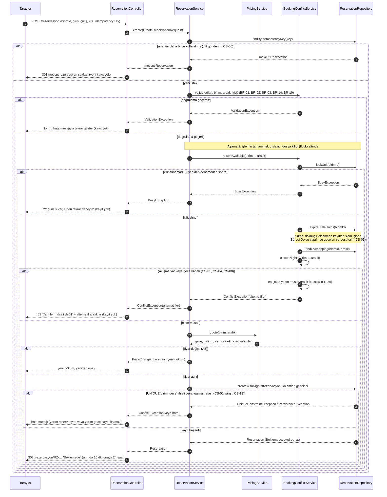
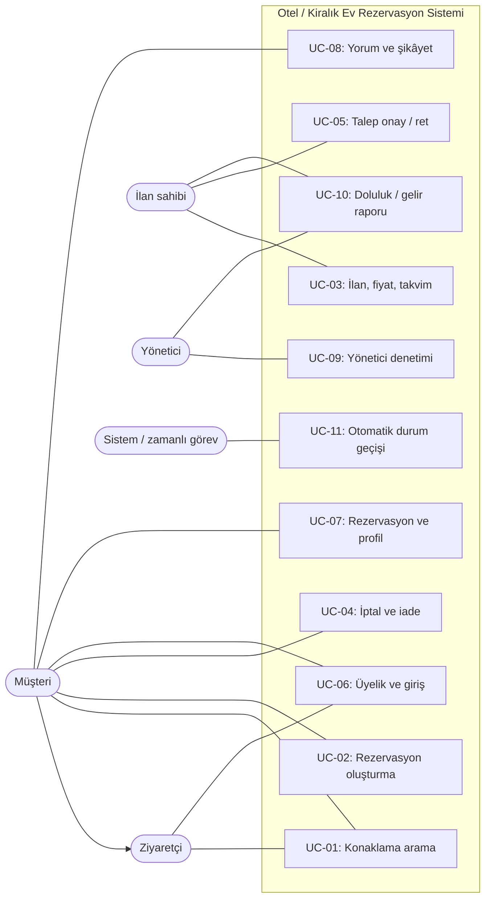
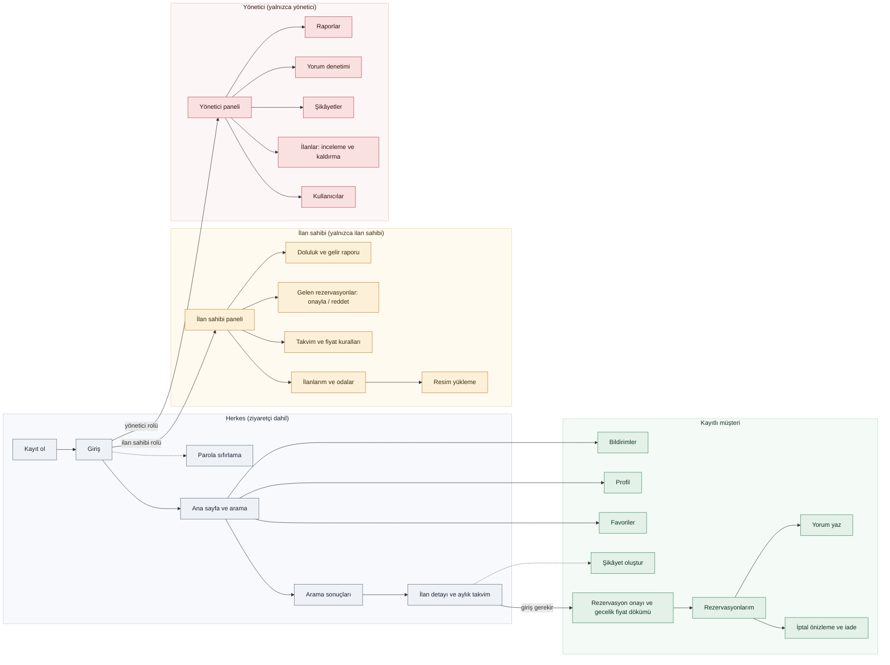
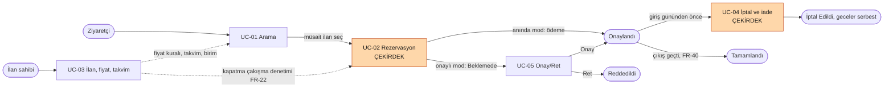
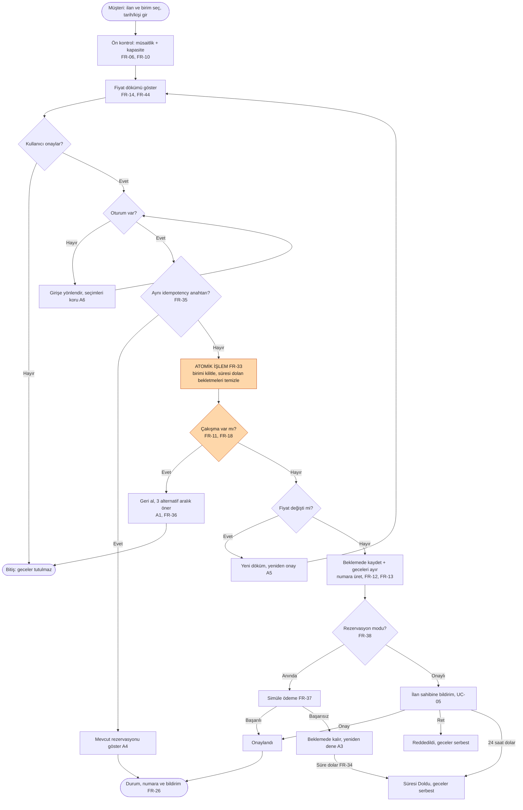

# Tasarım Dokümanı: Otel / Kiralık Ev Rezervasyon Sistemi

> Gereksinimler: [docs/srs.md](srs.md) (SRS v2.3). Bu belgedeki sınıf ve tablo adları, Aşama 2'de yazılan kodla (`src/`) ve SRS Bölüm 4.7 ile birebir aynıdır. Gereksinim–test eşlemesi koddan üretilir: [docs/test-izlenebilirlik.md](test-izlenebilirlik.md).

## 1. Mimari

Her istek aynı yoldan geçer: `public/index.php` → Router → Controller → Service → Repository. Her katmanın tek bir görevi vardır ve bir katman yalnızca altındaki katmanı çağırır.

| Katman | Görevi | Asla yapmaz | Otel rezervasyon örneği |
|---|---|---|---|
| Router | Adrese göre hangi controller metodunun çalışacağını seçer, rotanın erişim kuralını taşır | İş kuralı içermez | `POST /rezervasyon` → `ReservationController::store` (`config/routes.php`) |
| Controller | `$_POST/$_GET` verisini alır, servisi çağırır, görünümü seçer | SQL yazmaz, hesap yapmaz | `ReservationController` |
| Service | İş kuralları ve çekirdek algoritma | `$_POST` okumaz, HTML üretmez | `BookingConflictService::assertAvailable` (çakışma), `PricingService::quote` (gecelik döküm), `RefundService::quoteCustomerCancellation` (iade) |
| Repository | Veriyi okur ve yazar | İş kuralı içermez | `ReservationRepositoryInterface` → `JsonReservationRepository` (Aşama 2) / `MySqlReservationRepository` (Aşama 3) |
| Model | Veriyi taşıyan sade sınıf | Veritabanına erişmez | `Reservation`, `BookableUnit`, `Property` |
| View | HTML gösterir, çıktıyı kaçışlar (`e()`) | Hesap yapmaz, veri çekmez | `views/reservation/preview.php` |

**Çekirdek problem:** Tarih çakışması ve çift rezervasyonun önlenmesi (`BookingConflictService`), sezonluk dinamik fiyat (`PricingService`, Strategy deseni), iptal/iade hesabı (`RefundService`, Strategy deseni) ve rezervasyon yaşam döngüsü (`ReservationStateMachine`, State deseni).

### Klasör yapısı

```
ev-otel-rezervasyon/
├── public/              index.php (ön denetleyici), assets/app.css
├── config/              app.php (tüm sayısal ayarlar), routes.php (adres → controller + yetki)
├── bin/                 seed.php (örnek veri), gorev.php (zamanlanmış görev + günlük yedek),
│                        yedek.php (NFR-09), izlenebilirlik.php,
│                        eposta-dene.php (SMTP ayarını dener)
├── src/
│   ├── Router.php
│   ├── Core/            Kernel, Container, Request, Response, Session, Csrf, Auth, View
│   ├── Controller/      Home, Auth, Property, Reservation, Review, Profile,
│   │                    Complaint, Host, Admin, Api (JSON uç noktası), Mailbox (geliştirme posta kutusu)
│   ├── Service/         BookingConflict, Availability, Reservation, ReservationStateMachine,
│   │   │                Pricing, PriceRule, Refund, Payment, Property, Auth, User,
│   │   │                Favorite, Review, Notification, Complaint, Report, Photo,
│   │   │                Audit, ScheduledTask, ConsistencyAudit
│   │   ├── Pricing/     PricingStrategyInterface, BaseRate, Seasonal, Weekend,
│   │   │                LongStayDiscount stratejileri, PriceQuote
│   │   ├── Refund/      CancellationPolicyInterface, Flexible, Moderate, Strict
│   │   ├── State/       ReservationState ve 6 durum sınıfı
│   │   ├── Dto/         ekran ve istek veri taşıyıcıları
│   │   └── Mail/        MailerInterface; FileMailer + FileMailbox (simüle), SmtpMailer (isteğe bağlı gerçek gönderim)
│   ├── Repository/
│   │   ├── *RepositoryInterface.php, TransactionManagerInterface.php
│   │   └── Json/        (Aşama 2) JsonDatabase, JsonSchema, JsonTransactionManager + 17 depo sınıfı + JsonDataSnapshot
│   ├── Model/           User, Property, BookableUnit, Photo, Amenity, CalendarEntry,
│   │                    Reservation, ReservationNight, ReservationCharge, PriceRule,
│   │                    PricingRule, Payment, Review, Favorite, Notification,
│   │                    Complaint, AuditLog, PasswordResetToken, LoginAttempt + enum'lar
│   ├── Support/         DateRange, Money, Decimal, Clock, Logger, Paginator
│   ├── Exception/
│   └── Seed/            DemoSeeder (örnek veri; fotoğraf üretmez)
├── views/
├── storage/             data/ (JSON tablolar), uploads/, logs/, mail/, backups/ (son 7 yedek)
├── database/            (Aşama 3'te SQL migration'ları buraya gelecek)
├── tests/               Unit, Integration, Concurrency
└── docs/
```

**Kontrol sorusu:** Veritabanını değiştirirsek yalnızca `src/Repository/` altındaki sınıflar (ve `Core/Container.php` içindeki depo fabrikaları) değişir; servisler, controller'lar ve görünümler değişmez. Aşama 3'te MySQL için yalnızca `src/Repository/MySql/` eklenecek ve depo seçimi `Container::repository()` içinde yapılacak (bölüm 13). Katman kuralları `tests/Unit/ArchitectureTest.php` ile kodla denetlenir.

## 2. Sınıf Diyagramı

Diyagram, çekirdek akışı gösterir: rezervasyon oluşturma, çakışma kontrolü, Strategy ile gecelik fiyat hesabı, State ile durum geçişleri, iptal ve iade. Controller yalnızca Service'i, Service yalnızca Repository arayüzünü çağırır.

```mermaid
classDiagram
    class ReservationController {
        +preview() Response
        +store() Response
        +pay() Response
        +cancel() Response
    }

    class ReservationService {
        +preview(customerId, unitId, DateRange, guests) ReservationPreview
        +create(CreateReservationRequest) CreateReservationResult
        +pay(number, customerId, succeed) Payment
        +cancelByCustomer(number, customerId, reason) Reservation
        +approve(number, hostId) Reservation
        +reject(number, hostId, reason) Reservation
    }
    class BookingConflictService {
        +validate(Property, BookableUnit, DateRange, guests, customerId) void
        +isBlocking(Reservation) bool
        +isAvailable(unitId, DateRange) bool
        +assertAvailable(unitId, DateRange) void
        +expireStaleHolds(unitId) int
        +suggestAlternatives(unitId, DateRange) DateRange[]
        +nightStatuses(unitId, from, to) array
    }
    class AvailabilityService {
        +availableUnits(Property, DateRange, guests) BookableUnit[]
        +monthCalendar(unitId, year, month) MonthCalendar
        +setCalendarRange(ownerId, unitId, from, to, status, price) int
    }
    class PricingService {
        +quote(BookableUnit, DateRange) PriceQuote
    }
    class RefundService {
        +quoteCustomerCancellation(Reservation, paid, today) RefundQuote
        +fullRefund(paid) RefundQuote
    }
    class ReservationStateMachine {
        +transition(Reservation, to, actorId, reason) Reservation
    }

    class PricingStrategyInterface {
        <<interface>>
        +apply(PricingContext) void
    }
    class BaseRateStrategy
    class SeasonalStrategy
    class WeekendStrategy
    class LongStayDiscountStrategy

    class CancellationPolicyInterface {
        <<interface>>
        +refundPercent(daysLeft) int
        +description() string
    }
    class FlexiblePolicy
    class ModeratePolicy
    class StrictPolicy

    class ReservationState {
        <<abstract>>
        +holdsNights() bool
        +allowedNext() ReservationStatus[]
        +canTransitionTo(status) bool
    }
    class PendingState
    class ConfirmedState
    class CancelledState
    class RejectedState
    class ExpiredState
    class CompletedState

    class ReservationRepositoryInterface {
        <<interface>>
        +findOverlapping(unitId, DateRange) Reservation[]
        +createWithNights(Reservation, charges, nights) Reservation
        +updateStatusIf(id, expected, new, changes) bool
        +releaseNights(reservationId) int
        +findExpiredHolds(now, unitId) Reservation[]
        +findByIdempotencyKey(key) Reservation
        +lockUnit(unitId) void
    }
    class JsonReservationRepository
    class MySqlReservationRepository
    class CalendarRepositoryInterface {
        <<interface>>
    }
    class PriceRuleRepositoryInterface {
        <<interface>>
    }
    class PaymentService

    class Reservation {
        +string number
        +DateTimeImmutable checkIn
        +DateTimeImmutable checkOut
        +ReservationStatus status
        +int totalPrice
        +CancellationPolicy cancellationPolicy
    }
    class BookableUnit {
        +RoomType roomType
        +int capacity
        +int basePrice
    }
    class Property {
        +BookingMode bookingMode
        +CancellationPolicy cancellationPolicy
    }
    class PriceQuote {
        +NightPrice[] nights
        +int total
    }

    ReservationController --> ReservationService
    ReservationService --> BookingConflictService
    ReservationService --> PricingService
    ReservationService --> RefundService
    ReservationService --> PaymentService
    ReservationService --> ReservationStateMachine
    ReservationService --> ReservationRepositoryInterface
    AvailabilityService --> BookingConflictService
    BookingConflictService --> ReservationRepositoryInterface
    BookingConflictService --> CalendarRepositoryInterface
    BookingConflictService --> ReservationStateMachine
    PricingService --> PricingStrategyInterface
    PricingService --> PriceRuleRepositoryInterface
    RefundService --> CancellationPolicyInterface
    ReservationStateMachine --> ReservationState

    BaseRateStrategy ..|> PricingStrategyInterface
    SeasonalStrategy ..|> PricingStrategyInterface
    WeekendStrategy ..|> PricingStrategyInterface
    LongStayDiscountStrategy ..|> PricingStrategyInterface
    FlexiblePolicy ..|> CancellationPolicyInterface
    ModeratePolicy ..|> CancellationPolicyInterface
    StrictPolicy ..|> CancellationPolicyInterface
    PendingState --|> ReservationState
    ConfirmedState --|> ReservationState
    CancelledState --|> ReservationState
    RejectedState --|> ReservationState
    ExpiredState --|> ReservationState
    CompletedState --|> ReservationState
    JsonReservationRepository ..|> ReservationRepositoryInterface
    MySqlReservationRepository ..|> ReservationRepositoryInterface

    PricingService ..> PriceQuote
    ReservationRepositoryInterface ..> Reservation
    Reservation --> BookableUnit
    BookableUnit --> Property
```



### Diyagramın okunuşu
- **Strategy (fiyat):** `PricingService`, fiyat kurallarını `PricingStrategyInterface` üzerinden sabit bir sırayla çalıştırır. Yeni kural eklemek yeni bir sınıf eklemektir.
- **Strategy (iade):** `RefundService`, rezervasyonda saklanan politikaya karşılık gelen `CancellationPolicyInterface` sınıfını kullanır.
- **State:** `ReservationStateMachine`, her durumun izin verdiği geçişleri durum sınıfına sorar; geçersiz geçiş reddedilir ve denetim kaydına yazılır.
- **Repository:** Servisler yalnızca `...RepositoryInterface` bilir. JSON (Aşama 2) ve MySQL/PDO (Aşama 3) uygulamaları aynı arayüzü uygular.
- **Çekirdek problem:** `BookingConflictService::assertAvailable`, `findOverlapping` ile çakışmaları arar. Aynı gün çıkış-giriş çakışma sayılmaz. Arama ve takvim de aynı sınıfı kullanır (tek kural, tek kod yolu).

> Sunumda anlatan: İrem Ablak

## 3. ER Diyagramı

```mermaid
erDiagram
    USERS ||--o{ PROPERTIES : "sahip olur"
    USERS ||--o{ RESERVATIONS : "yapar"
    USERS ||--o{ REVIEWS : "yazar"
    USERS ||--o{ FAVORITES : "ekler"
    USERS ||--o{ NOTIFICATIONS : "alır"
    USERS ||--o{ COMPLAINTS : "gönderir"
    USERS ||--o{ PASSWORD_RESET_TOKENS : "talep eder"
    USERS |o--o{ AUDIT_LOGS : "işlem yapar"

    PROPERTIES ||--|{ BOOKABLE_UNITS : "içerir"
    PROPERTIES ||--o{ PHOTOS : "sahiptir"
    PROPERTIES ||--o{ PROPERTY_AMENITIES : "sunar"
    AMENITIES ||--o{ PROPERTY_AMENITIES : "ilan listesinde yer alır"
    PROPERTIES ||--o{ PRICE_RULES : "sezon, hafta sonu, uzun konaklama"
    PROPERTIES ||--o{ PRICING_RULES : "vergi ve ek ücret"
    PROPERTIES ||--o{ FAVORITES : "favorilenir"
    PROPERTIES |o--o{ COMPLAINTS : "hakkında"

    BOOKABLE_UNITS |o--o{ PRICE_RULES : "birime özel kural"
    BOOKABLE_UNITS |o--o{ PHOTOS : "birime ait"
    BOOKABLE_UNITS ||--o{ CALENDAR_ENTRIES : "istisna tanımlanır"
    BOOKABLE_UNITS ||--o{ RESERVATIONS : "ayrılır"
    BOOKABLE_UNITS ||--o{ RESERVATION_NIGHTS : "geceleri tutulur"

    RESERVATIONS ||--o{ RESERVATION_NIGHTS : "engelleyen geceler"
    RESERVATIONS ||--|{ RESERVATION_CHARGES : "kalemlere ayrılır"
    RESERVATIONS ||--o{ PAYMENTS : "ödenir"
    RESERVATIONS ||--o| REVIEWS : "yorumlanır"
    RESERVATIONS |o--o{ COMPLAINTS : "hakkında"

    USERS {
        int id PK
        string first_name
        string last_name
        string email UK
        string password_hash
        enum role "musteri, ilan_sahibi, yonetici"
        enum status "aktif, kisitli"
        datetime created_at
    }
    LOGIN_ATTEMPTS {
        string email PK
        int failed_count
        datetime last_failed_at
        datetime locked_until "NULL olabilir"
    }
    PROPERTIES {
        int id PK
        int owner_id FK
        string name
        enum type "otel, kiralik_ev"
        text description
        string address
        string city
        enum booking_mode "aninda, onayli"
        enum cancellation_policy "esnek, orta, kati"
        enum status "taslak, aktif, pasif, kaldirildi"
    }
    BOOKABLE_UNITS {
        int id PK
        int property_id FK
        string name "UK (property_id, name)"
        enum room_type "tek_kisilik, cift_kisilik, aile, suit, mustakil_ev, daire"
        int capacity
        decimal base_price "DECIMAL(10,2)"
        enum status "aktif, pasif"
    }
    PHOTOS {
        int id PK
        int property_id FK
        int unit_id FK "NULL olabilir"
        string file_name UK "rastgele üretilir"
        string mime_type
        int size_bytes
        int sort_order
    }
    AMENITIES {
        int id PK
        string name UK
    }
    PROPERTY_AMENITIES {
        int property_id PK, FK
        int amenity_id PK, FK
    }
    CALENDAR_ENTRIES {
        int id PK
        int unit_id FK "UK (unit_id, date)"
        date date
        enum status "acik, kapali"
        decimal special_price "NULL olabilir"
    }
    PRICE_RULES {
        int id PK
        int property_id FK
        int unit_id FK "NULL: tüm birimler"
        enum type "sezon, hafta_sonu, uzun_konaklama"
        string name
        date start_date "yalnızca sezon"
        date end_date "yalnızca sezon"
        int min_nights "yalnızca uzun konaklama"
        decimal value "DECIMAL(10,2)"
        enum value_type "yuzde, sabit"
        int priority
    }
    PRICING_RULES {
        int id PK
        int property_id FK
        string name
        enum type "vergi, ek_ucret"
        enum calc_method "yuzde, gecelik_sabit, rezervasyon_basina_sabit"
        decimal value "DECIMAL(10,2)"
    }
    RESERVATIONS {
        int id PK "UK (id, unit_id)"
        string reservation_no UK "RZ-YYYYMMDD-XXXXXX"
        int customer_id FK
        int unit_id FK
        date check_in "CHECK check_out > check_in"
        date check_out
        int guest_count
        enum status "beklemede, onaylandi, iptal_edildi, reddedildi, suresi_doldu, tamamlandi"
        datetime expires_at
        decimal total_price "DECIMAL(10,2)"
        enum cancellation_policy "anlık görüntü (BR-29)"
        string idempotency_key UK
        string contact_name
        string contact_phone
        string note "NULL olabilir"
        string cancel_reason
        datetime cancelled_at
        decimal refund_amount "DECIMAL(10,2)"
        datetime created_at
        datetime updated_at
    }
    RESERVATION_NIGHTS {
        int reservation_id PK, FK
        date night_date PK
        int unit_id FK "UK (unit_id, night_date)"
    }
    RESERVATION_CHARGES {
        int id PK
        int reservation_id FK
        enum type "konaklama_gecesi, indirim, vergi, ek_ucret"
        date night_date "yalnızca konaklama gecesi"
        string description
        decimal amount "DECIMAL(10,2); indirim eksi"
    }
    PAYMENTS {
        int id PK
        int reservation_id FK
        string provider_ref UK
        decimal amount "DECIMAL(10,2)"
        decimal refund_amount "DECIMAL(10,2)"
        string currency
        enum status "beklemede, basarili, basarisiz, kismen_iade, iade_edildi"
        datetime created_at
    }
    REVIEWS {
        int id PK
        int reservation_id FK, UK
        int customer_id FK
        tinyint rating "1-5"
        text comment
        enum moderation_status "yayinda, incelemede, gizlendi"
        datetime created_at
    }
    FAVORITES {
        int user_id PK, FK
        int property_id PK, FK
        datetime added_at
    }
    NOTIFICATIONS {
        int id PK
        int user_id FK
        string type
        string message
        boolean is_read
        datetime created_at
    }
    COMPLAINTS {
        int id PK
        int sender_id FK
        int property_id FK "NULL olabilir"
        int reservation_id FK "NULL olabilir"
        text description
        enum status "yeni, inceleniyor, cozuldu, reddedildi"
        text admin_note
        datetime created_at
    }
    AUDIT_LOGS {
        int id PK
        int actor_id FK "sistem islemlerinde NULL"
        string entity_type
        int entity_id
        string action
        string old_value
        string new_value
        string reason
        datetime created_at
    }
    PASSWORD_RESET_TOKENS {
        int id PK
        int user_id FK
        string token_hash UK
        datetime expires_at
        datetime used_at "NULL olabilir"
    }
```

ER diyagramı SRS Bölüm 7 ile hizalanmıştır. Aşama 2'de her tablo `storage/data/<tablo>.json` dosyasıdır ve aynı anahtar/benzersizlik kısıtları `src/Repository/Json/JsonSchema.php` içinde uygulanır.



### Normalizasyon Gerekçesi

Her varlık kendi tablosunda tutulmuş, tekrarlayan veriler (fotoğraf, olanak, gece, fiyat kalemi, favori) ara veya alt tablolara ayrılarak **1NF** sağlanmıştır. Bileşik anahtarlı tablolarda (`PROPERTY_AMENITIES`, `FAVORITES`, `RESERVATION_NIGHTS`) yalnızca anahtarın tamamına bağlı sütunlar bırakıldığı için **2NF** sağlanır. Müşteri, ilan veya şehir gibi bilgiler yalnızca bir tabloda tutulur ve diğer tablolar bunlara FK ile bağlanır; böylece anahtar olmayan sütunlar arasında geçişli bağımlılık kalmaz ve **3NF** sağlanır. Yorumun ait olduğu ilan da ayrı bir sütunda tutulmaz; `REVIEWS ⋈ RESERVATIONS ⋈ BOOKABLE_UNITS` birleştirmesiyle bulunur.

**Bilinçli iki istisna:**

1. `RESERVATION_NIGHTS.unit_id`: Kesin 3NF'ye göre fazlalıktır; ancak veritabanının `UNIQUE (unit_id, night_date)` kısıtını uygulayabilmesi için gereklidir. Bu kısıt çift rezervasyona karşı son savunmadır. Tutarsızlığı `(reservation_id, unit_id)` bileşik FK'si önler.
2. `RESERVATIONS.total_price`: `RESERVATION_CHARGES` toplamından türetilebilir; ancak fiyat anlık görüntüsü olarak bilinçli saklanır (BR-16) ve testle kalemlerin toplamına eşitliği doğrulanır.

> Sunumda anlatan: İrem Ablak

## 4. Sıralama Diyagramı: Rezervasyon Oluşturma (Çekirdek: Çift Rezervasyon Önleme)



> Sunumda anlatan: İrem Ablak

### Diyagramdaki durumlar

| Dal | Senaryo | Sonuç |
| --- | --- | --- |
| Başarılı | Birim müsait, kayıt ve geceler tek işlemde yazıldı | Rezervasyon Beklemede olur, geceler tutulur |
| Hata 1 | Çift gönderim (CS-06) | Yeni kayıt oluşmaz, mevcut rezervasyon gösterilir |
| Hata 2 | Geçersiz tarih, kapasite aşımı, pasif ilan | ValidationException, kayıt yok |
| Hata 3 | Kilit alınamadı | 2 deneme sonrası "yoğunluk" mesajı, kayıt yok |
| Hata 4 | Çakışma veya kapalı gece (CS-01, 04, 08) | ConflictException, en çok 3 alternatif önerilir |
| Hata 5 | UNIQUE(birim, gece) ihlali veya yazma hatası (CS-12) | Rollback, yarım kayıt kalmaz |

## 5. Tasarım Desenleri

### 5.1 Repository Deseni (Zorunlu)
1. **Problem:** Projede kullanıcı, ilan, müsaitlik, rezervasyon, ödeme, yorum, favori, bildirim ve şikâyet olmak üzere çok sayıda kalıcı veri varlığı vardır. Veriye erişim kodu (SQL, dosya okuma) doğrudan servis sınıflarının içine yazılırsa, Aşama 2'de JSON dosyalarıyla Aşama 3'te MySQL ile çalışmak istendiğinde tüm iş mantığı kodunun değişmesi gerekir.
2. **Desen:** Repository deseni; `UserRepositoryInterface`, `PropertyRepositoryInterface`, `ReservationRepositoryInterface`, `CalendarRepositoryInterface`, `ReviewRepositoryInterface` gibi arayüzler ve bunların `MySql*Repository` (Aşama 3) ile `Json*Repository` (Aşama 2) somut uygulamalarıyla kurulur. Servis sınıfları (`ReservationService`, `BookingConflictService`, `PricingService`) yalnızca arayüzü tanır; gerçek veritabanı sınıfını bilmez. Atomik işlem de bir arayüzdür (`TransactionManagerInterface`).
3. **Alternatif:** Servis sınıflarının içinde doğrudan PDO veya `file_get_contents()` çağrıları yapmak; yani katmansız, veri erişimi ile iş kuralını aynı sınıfta toplamak.
4. **Neden:** Depolama katmanı değiştiğinde (JSON → MySQL) yalnızca yeni bir `MySql*Repository` sınıfı yazılır; `ReservationService` ve `BookingConflictService` içindeki çekirdek iş kuralı (tarih çakışma kontrolü) hiç değişmez. Bu, SRS'teki NFR-08 (Bakım yapılabilirlik) ve FR-18 (çift rezervasyon engeli) gereksinimlerinin sürdürülebilir biçimde karşılanmasını sağlar.

### 5.2 Strategy Deseni (Fiyatlandırma)
1. **Problem:** SRS'teki FR-43, ilan sahibinin sezon, hafta sonu ve uzun konaklama kurallarını tanımlamasını; FR-14 ise gecelik fiyat ile vergi/ek ücretlerin ayrı ayrı hesaplanmasını zorunlu kılar. Aynı ilan için hafta sonu farklı fiyat, yüksek sezon farklı fiyat, uzun konaklamada indirim uygulanabilir. Bu kuralların tümünü `PricingService` içinde `if ($tarih hafta sonu mu) ... elseif ($sezon mu) ... elseif ($gece > 7) ...` zinciriyle yazmak hem okunması zor hem de yeni bir kural (örneğin "son dakika indirimi") eklendiğinde mevcut çalışan kodu bozar.
2. **Desen:** Strategy deseni; `PricingStrategyInterface` arayüzü ile `BaseRateStrategy`, `SeasonalStrategy`, `WeekendStrategy` ve `LongStayDiscountStrategy` somut strateji sınıfları üzerinden uygulanır. `PricingService::quote(BookableUnit, DateRange)` metodu, `PriceRuleRepositoryInterface`'ten gelen kuralları bir `PricingContext` içinde stratejilere sırayla (BR-23 – BR-26) uygular, her geceyi tek seferde kuruşa yuvarlar ve `PriceQuote` (gecelik döküm, indirim, vergi, ek ücret) döndürür. Sınıf diyagramında bu ilişki `PricingService --> PricingStrategyInterface` ve `WeekendStrategy ..|> PricingStrategyInterface` olarak gösterilmiştir.
3. **Alternatif:** Tek bir `PricingService` sınıfı içinde iç içe if/elseif bloklarıyla tüm fiyat kurallarını yönetmek; yani desensiz, tek sorumluluk ilkesini bozan çözüm.
4. **Neden:** Yeni bir fiyat kuralı (örneğin "bayram dönemi zammı" veya "erken rezervasyon indirimi") eklemek için mevcut `PricingService` veya diğer strateji sınıflarına dokunmadan yalnızca yeni bir sınıf (`HolidayPricingStrategy`) yazıp arayüzü uygulamak yeterlidir. Bu, Açık/Kapalı Prensibi'ne (OCP) uygundur; ayrıca her strateji bağımsız olarak birim testine tabi tutulabildiği için SRS'teki AC-08 (toplam fiyatın onay öncesi açık gösterimi) ve kılavuzdaki test şartı daha güvenilir biçimde karşılanır. Sunumda "Hangi sınıflar bu deseni oluşturuyor?" sorusuna `PricingStrategyInterface` ile dört somut strateji sınıfı sınıf diyagramı üzerinde gösterilerek cevap verilir.

### 5.3 State Deseni (Rezervasyon durum makinesi)
1. **Problem:** Rezervasyon altı durumdan geçer (Beklemede, Onaylandı, İptal Edildi, Reddedildi, Süresi Doldu, Tamamlandı) ve hangi durumun gecelerini tuttuğu çakışma kuralının temelidir (SRS 4.3). Geçiş kuralları servislerin içine dağınık `if ($status === ...)` blokları olarak yazılırsa, izinsiz bir geçiş (örneğin İptal Edildi → Onaylandı) gözden kaçar ve tutarsız doluluk oluşur.
2. **Desen:** State deseni; soyut `ReservationState` sınıfı ve `PendingState`, `ConfirmedState`, `CancelledState`, `RejectedState`, `ExpiredState`, `CompletedState` alt sınıflarıyla uygulanır. Her durum, gecelerini tutup tutmadığını (`holdsNights`) ve hangi durumlara geçebileceğini (`allowedNext`) bilir. Tüm geçişler tek yerden, `ReservationStateMachine::transition()` ile yapılır: izin denetlenir, koşullu güncelleme (`updateStatusIf`) yapılır, engellemeyen duruma geçildiyse geceler aynı işlemde serbest bırakılır ve denetim kaydı yazılır.
3. **Alternatif:** Durumu yalnızca bir metin alanı olarak tutup geçiş kurallarını her serviste ayrı ayrı `switch` ile denetlemek.
4. **Neden:** Geçiş tablosu tek bir yerde ve okunabilir sınıflarda durduğu için FR-15 ("tabloda olmayan her geçiş reddedilir") doğrudan test edilebilir (T-02: 36 durum çifti). Yeni bir durum eklemek yeni bir sınıf eklemektir; koşullu güncelleme sayesinde aynı anda iki işlem aynı rezervasyonun durumunu değiştirmeye çalışırsa yalnızca biri başarılı olur.

### 5.4 Strategy Deseni (İptal politikası ve iade)
1. **Problem:** Üç iptal politikası (Esnek, Orta, Katı) farklı eşik günleri ve iade oranları kullanır (BR-17); iade, rezervasyon anındaki politikaya göre hesaplanmalıdır (BR-29).
2. **Desen:** `CancellationPolicyInterface` arayüzü ve `FlexiblePolicy`, `ModeratePolicy`, `StrictPolicy` sınıfları. `RefundService`, rezervasyonda saklanan politika değerine karşılık gelen stratejiyi `CancellationPolicyFactory` ile alır ve kalan güne göre oranı ona sorar; tutarı kuruşa yarıdan yukarı yuvarlar.
3. **Alternatif:** `RefundService` içinde politika adına göre `if/else` zinciri.
4. **Neden:** Yeni bir politika (ör. "iade edilmez") yeni bir sınıftır; mevcut politikalar ve servis değişmez. Her politikanın eşik günleri (13/14, 4/5, 0/1) veri güdümlü testle (T-14) ayrı ayrı doğrulanır.

## 6. Risk Tablosu

| Kimlik | Risk | Kategori | Olasılık | Etki | Olasılık Puanı | Etki Puanı | Risk Skoru | Seviye | Önlem | İlgili Test / Gereksinim | Kaynak |
| :--- | :--- | :--- | :--- | :--- | :---: | :---: | :---: | :---: | :--- | :--- | :--- |
| **R1** | Eş zamanlı isteklerde "önce kontrol et, sonra kaydet" yarışı yüzünden çift rezervasyon oluşması | Çekirdek | Orta | Yüksek | 2 | 3 | 6 | Yüksek | Transaction + birim satırı kilidi (SELECT ... FOR UPDATE) + UNIQUE(birim, gece) kısıtı. Aşama 2'de dosya kilidi. T-05 (50 paralel istek) ve T-06 testleri. | T-05, T-06, FR-18, FR-33 | SRS 4.9 |
| **R2** | Sınır günü hatası: çıkış gününün gece sayılıp sayılmaması | Çekirdek | Yüksek | Yüksek | 3 | 3 | 9 | Yüksek | Yarı açık aralık [giriş, çıkış) tek tanımı. Tüm kodda tek karşılaştırma fonksiyonu (`DateRange::overlaps`). Veri güdümlü T-01 testi (8 durum). | T-01, BR-11, BR-13 | SRS 4.9 |
| **R3** | Arama ve rezervasyonun farklı kural uygulaması (aramada görünen ama rezervasyonda reddedilen birim) | Çekirdek | Orta | Orta | 2 | 2 | 4 | Orta | Kuralın tek kopyası (`BookingConflictService`). AvailabilityService kuralı kendisi yazmaz, bu servisi kullanır. T-08 tutarlılık testi. | T-08, FR-06, FR-10, FR-11 | SRS 4.9 |
| **R4** | Süresi dolmuş "hayalet" bekletmelerin geceleri gereksiz yere bloke etmesi | Çekirdek | Orta | Orta | 2 | 2 | 4 | Orta | Lazy expiry (çakışma kontrolü sırasında temizleme) + dakikada bir çalışan zamanlanmış görev. T-03 testi. | T-03, FR-34, CS-05 | SRS 4.9 |
| **R5** | Aşama 2'deki JSON depoda eşzamanlı yazmayla dosya bozulması veya çift kayıt | Çekirdek | Orta | Yüksek | 2 | 3 | 6 | Yüksek | flock(LOCK_EX) altında tek kritik bölüm. Önce geçici dosyaya yazıp yeniden adlandırma, yarım kalan yazma için günlük (journal). T-10 testi. | T-10, SRS 4.5 | SRS 4.9 |
| **R6** | Yarım kayıt: rezervasyon yazıldıktan sonra gece kaydı eklenirken hata veya sunucu kesintisi | Çekirdek | Düşük | Yüksek | 1 | 3 | 3 | Orta | Rezervasyon, gece ve kalemler tek atomik işlemde yazılır (`createWithNights`). Hata durumunda geri alma. T-07 hata enjeksiyon testi. | T-07, FR-33, CS-12 | SRS 4.6 (CS-12) |
| **R7** | Yapay zekâ üretimi kodun çakışma kontrolünü Controller'a veya yanlış katmana koyması | Çekirdek | Yüksek | Orta | 3 | 2 | 6 | Yüksek | Her istemde mimari tablo ve SRS Bölüm 4.7 bağlam olarak verilir. PR incelemesinde katman kuralı kontrol edilir (Controller → Repository oku yok). | SRS 4.7, katmanlı mimari | SRS 4.9 |
| **R8** | Kapsamın büyümesi (46 FR, çok sayıda varlık, kısıtlı süre) | Genel | Yüksek | Orta | 3 | 2 | 6 | Yüksek | Backlog'ta önce çekirdek etiketli işler. SRS'deki kapsam dışı listesine (overbooking, kanal yöneticisi, gerçek ödeme) sadık kalmak. | SRS 4.1, SRS 11.2 | Kılavuz (projeye uyarlandı) |
| **R9** | Bir üyenin katkı vermemesi (4 kişilik ekip, 4 rol) | Genel | Orta | Yüksek | 2 | 3 | 6 | Yüksek | Her issue'ya sorumlu atamak, haftalık toplantı, sorunu erken bildirmek, panoda Group by Assignees ile iş dağılımını izlemek. | GitHub Projects backlog | Kılavuz |
| **R10** | Aynı dosyada çakışan değişiklikler (Git) | Genel | Yüksek | Düşük | 3 | 1 | 3 | Orta | Dal + pull request, main için onay zorunluluğu, işleri dosya bazında bölmek. | Git dal ve PR akışı | Kılavuz |
| **R11** | Ortam sorunları (PHP sürümü, Composer, MySQL) | Genel | Düşük | Orta | 1 | 2 | 2 | Düşük | İlk hafta kurulum ve doğrulama (composer install). Sorun olursa Laragon. PHP >= 8.2 sürümünün herkeste aynı olduğunu kontrol etmek. | Adım 0: Composer kurulumu | Kılavuz |
| **R12** | Süre, limit ve iade oranı gibi sayısal kararların onaysız olması | Genel | Orta | Orta | 2 | 2 | 4 | Orta | Ekip içinde doğrulama toplantısı, ders yürütücüsüyle onay, değerlerin tek yerde (`config/app.php`) tutulması. | SRS 11.4 | SRS 11.4 (varsayımlar) |

## 7. Kullanım Senaryosu (Use Case) Diyagramı



## 8. Arayüz Sayfa Haritası



Renkler rolü gösterir: gri = herkes, yeşil = kayıtlı müşteri, turuncu = yalnızca ilan sahibi, kırmızı = yalnızca yönetici. Yetki sunucu tarafında da denetlenir (NFR-03): her rota `config/routes.php` içinde erişim kuralıyla tanımlıdır.

### 8.1 Ekran taslakları

| Taslak | Uygulamadaki sayfa |
| --- | --- |
|  | `/` – `views/home/index.php` |
|  | `/ara` – `views/property/search.php` |
|  | `/ilan/{id}` – `views/property/show.php` |
|  | `/rezervasyon/onizleme` – `views/reservation/preview.php` |
|  | `/giris` – `views/auth/login.php` |
|  | `/panel/takvim` – `views/host/calendar.php` |

## 9. İzlenebilirlik Matrisi

Eşleme, SRS'teki FR kartlarının "Olay/Kullanım Senaryosu" ve "Destekleyici Materyal" alanlarından çıkarıldı (Ek B ile uyumlu). Kalın yazılan ÇEKİRDEK gereksinimdir.

> **Gereksinim → otomatik test eşlemesi** (her FR/NFR/BR/AC/CS/T kodunu doğrulayan PHPUnit testleri, sonuçları, NFR-16 kapsamı) koddan üretilen [test-izlenebilirlik.md](test-izlenebilirlik.md) dosyasındadır; aşağıdaki tablo tasarım bileşeni eşlemesidir. Her gereksinim GitHub'da bir issue'dur (aşamalar milestone).

| UC | Senaryo | FR sayısı | Çekirdek FR | AC sayısı | Test sayısı |
| --- | --- | --- | --- | --- | --- |
| **UC-01** | Konaklama Arama | 5 | 3 | 4 | 3 |
| **UC-02** | Rezervasyon Oluşturma | 15 | 11 | 16 | 10 |
| **UC-03** | İlan/Fiyat/Takvim Yönetimi | 7 | 2 | 6 | 2 |
| **UC-04** | İptal ve İade | 5 | 4 | 5 | 2 |
| **UC-05** | Talep Onay/Ret | 4 | 2 | 2 | 1 |

| FR | Öncelik | UC-01 | UC-02 | UC-03 | UC-04 | UC-05 | BR | AC | Test | Tasarım bileşeni |
| --- | --- | --- | --- | --- | --- | --- | --- | --- | --- | --- |
| **FR-01** | Zorunlu |  |  |  |  |  |  | 01 |  | AuthController → AuthService |
| **FR-02** | Zorunlu |  |  |  |  |  |  |  |  | AuthController → AuthService |
| **FR-03** | Zorunlu |  |  |  |  |  |  |  |  | AuthController → AuthService |
| **FR-04** | Gerekli |  |  |  |  |  |  |  |  | AuthController → AuthService |
| **FR-05** | Zorunlu |  |  |  |  |  |  | 06, 07 |  | Router + Kernel (rota yetkisi), servislerde sahiplik denetimi |
| **FR-06** | Çekirdek | ● |  |  |  |  | BR-01, BR-02, BR-14 | 02, 20 | T-08 | PropertyController → PropertyService → BookingConflictService |
| **FR-07** | Gerekli | ● |  |  |  |  |  | 29 |  | PropertyController → PropertyService |
| **FR-08** | Gerekli | ● |  |  |  |  |  |  |  | PropertyController → PropertyService |
| **FR-09** | Zorunlu |  |  |  |  |  | BR-06 |  |  | PropertyController → PropertyService |
| **FR-10** | Çekirdek | ● | ● |  |  |  |  | 32 | T-08 | PropertyController → AvailabilityService → BookingConflictService |
| **FR-44** | Çekirdek | ● | ● |  |  |  | BR-23, BR-26 |  | T-12, T-13 | PropertyController → PricingService |
| **FR-11** | Çekirdek |  | ● |  |  |  |  | 12 | T-05 | ReservationController → BookingConflictService |
| **FR-12** | Çekirdek |  | ● |  |  |  | BR-05, BR-15 |  |  | ReservationController → ReservationService |
| **FR-13** | Zorunlu |  | ● |  |  |  |  | 04 |  | ReservationController → ReservationService |
| **FR-18** | Çekirdek |  | ● |  |  |  | BR-11, BR-12, BR-13 | 05, 13, 22 | T-05, T-06, T-11 | ReservationController → BookingConflictService |
| **FR-33** | Çekirdek |  | ● |  |  |  |  | 12 | T-07 | ReservationService → BookingConflictService |
| **FR-34** | Çekirdek |  | ● |  |  |  | BR-15 | 15 | T-03 | ReservationService → BookingConflictService |
| **FR-35** | Çekirdek |  | ● |  |  |  |  | 17 | T-04 | ReservationController → ReservationService |
| **FR-36** | Çekirdek |  | ● |  |  |  |  | 12 |  | ReservationController → BookingConflictService |
| **FR-37** | Zorunlu |  | ● |  |  |  | BR-05 | 19 |  | ReservationController → PaymentService |
| **FR-14** | Çekirdek |  | ● |  |  |  | BR-07, BR-16, BR-23, BR-26 | 08, 21, 23, 24, 25 | T-12, T-13 | ReservationController → PricingService |
| **FR-43** | Çekirdek |  |  | ● |  |  | BR-23, BR-26 | 25 | T-12 | HostController → PriceRuleService (hesap: PricingService) |
| **FR-15** | Çekirdek |  | ● |  | ● | ● | BR-12 |  | T-02 | ReservationService → ReservationStateMachine |
| **FR-16** | Gerekli |  |  |  |  |  |  | 06 |  | ReservationController → ReservationService |
| **FR-17** | Çekirdek |  |  |  | ● |  | BR-17, BR-18 | 16, 26, 27 | T-02, T-14 | ReservationController → ReservationService |
| **FR-40** | Zorunlu |  |  |  |  |  | BR-09, BR-30 |  |  | bin/gorev.php → ScheduledTaskService → ReservationService |
| **FR-45** | Çekirdek |  |  |  | ● |  | BR-17, BR-27, BR-28, BR-29 | 26, 27, 28 | T-14 | ReservationController → RefundService |
| **FR-20** | Zorunlu |  |  | ● |  |  |  | 07 |  | HostController → PropertyService |
| **FR-21** | Zorunlu |  |  | ● |  |  | BR-08 | 07 |  | HostController → PropertyService |
| **FR-22** | Çekirdek |  |  | ● |  |  | BR-22 | 18, 25 | T-09 | HostController → AvailabilityService |
| **FR-23** | Çekirdek |  |  |  |  | ● | BR-05, BR-08, BR-15 | 07 |  | HostController → ReservationService |
| **FR-38** | Zorunlu |  |  | ● |  |  | BR-05, BR-17 | 28 |  | HostController → PropertyService |
| **FR-42** | Zorunlu |  |  | ● |  |  | BR-04 | 29 |  | HostController → PropertyService |
| **FR-46** | Gerekli |  |  | ● |  |  |  | 31 |  | HostController → PhotoService |
| **FR-19** | İsteğe bağlı |  |  |  |  |  |  |  |  | ProfileController → FavoriteService |
| **FR-24** | Gerekli |  |  |  |  |  | BR-09, BR-21 |  |  | ReviewController → ReviewService |
| **FR-25** | Gerekli |  |  |  |  |  | BR-10 |  |  | AdminController → ReviewService |
| **FR-26** | Gerekli |  | ● |  | ● | ● |  |  |  | ReservationService → NotificationService |
| **FR-27** | Gerekli |  |  |  |  |  |  |  |  | ComplaintController → ComplaintService |
| **FR-31** | Gerekli |  |  |  |  |  |  |  |  | ProfileController → UserService |
| **FR-32** | Gerekli |  | ● |  |  | ● |  | 06, 07 |  | ReservationController → ReservationService |
| **FR-28** | Gerekli |  |  |  |  |  | BR-10 | 09 |  | AdminController → PropertyService |
| **FR-29** | Gerekli |  |  |  |  |  | BR-10 |  |  | AdminController → UserService |
| **FR-30** | Gerekli |  |  |  |  |  | BR-30 | 30 | T-15 | AdminController, HostController → ReportService |
| **FR-39** | Çekirdek |  |  |  | ● |  | BR-10, BR-28 | 09, 27 |  | AdminController → PropertyService → ReservationService |
| **FR-41** | Gerekli |  |  |  |  |  | BR-10 |  |  | ReservationStateMachine, AdminController → AuditService |

17 FR hiçbir UC'ye bağlı değil (FR-01–05, 09, 16, 19, 24, 25, 27–31, 40, 41): hesap, profil, yorum, yönetim ve rapor işlevleri. Bunlar için UC yazılmamış, yalnızca US/AC düzeyinde izleniyorlar. İzlenebilirlik açığıdır.

## 10. Akış Diyagramları

Genel senaryo akışı



UC-02 Rezervasyon oluşturma (temel akış ve A1–A7 alternatifleri)



## 11. Maliyet-Değer Grafiği

```mermaid
%%{init: {"quadrantChart": {"chartWidth": 900, "chartHeight": 700, "pointLabelFontSize": 10, "pointTextPadding": 4}}}%%
quadrantChart
    title Gereksinim maliyet-değer grafiği (SRS v2.3)
    x-axis Düşük maliyet --> Yüksek maliyet
    y-axis Düşük değer --> Yüksek değer
    quadrant-1 Stratejik (pahalı, değerli)
    quadrant-2 Önce yap (ucuz, değerli)
    quadrant-3 Fırsat (ucuz, düşük değer)
    quadrant-4 Ertelenebilir (pahalı, düşük değer)
    FR-19: [0.065, 0.100] radius: 6, color: #2563eb
    FR-03: [0.065, 0.420] radius: 6, color: #2563eb
    FR-13: [0.100, 0.420] radius: 6, color: #2563eb
    FR-32: [0.135, 0.420] radius: 6, color: #2563eb
    FR-04: [0.225, 0.260] radius: 6, color: #2563eb
    FR-08: [0.260, 0.260] radius: 6, color: #2563eb
    FR-25: [0.295, 0.260] radius: 6, color: #2563eb
    FR-26: [0.225, 0.225] radius: 6, color: #2563eb
    FR-27: [0.260, 0.225] radius: 6, color: #2563eb
    FR-31: [0.295, 0.225] radius: 6, color: #2563eb
    FR-29: [0.225, 0.190] radius: 6, color: #2563eb
    FR-37: [0.225, 0.420] radius: 6, color: #2563eb
    FR-40: [0.260, 0.420] radius: 6, color: #2563eb
    FR-28: [0.295, 0.420] radius: 6, color: #2563eb
    FR-01: [0.225, 0.580] radius: 6, color: #2563eb
    FR-02: [0.260, 0.580] radius: 6, color: #2563eb
    FR-09: [0.295, 0.580] radius: 6, color: #2563eb
    FR-35: [0.225, 0.545] radius: 6, color: #c2410c
    FR-16: [0.260, 0.545] radius: 6, color: #2563eb
    FR-21: [0.295, 0.545] radius: 6, color: #2563eb
    FR-38: [0.225, 0.510] radius: 6, color: #2563eb
    FR-20: [0.225, 0.740] radius: 6, color: #2563eb
    FR-42: [0.260, 0.740] radius: 6, color: #2563eb
    FR-24: [0.385, 0.260] radius: 6, color: #2563eb
    FR-41: [0.420, 0.260] radius: 6, color: #2563eb
    FR-07: [0.385, 0.420] radius: 6, color: #2563eb
    FR-36: [0.420, 0.420] radius: 6, color: #c2410c
    FR-46: [0.455, 0.420] radius: 6, color: #2563eb
    FR-05: [0.385, 0.580] radius: 6, color: #2563eb
    FR-10: [0.420, 0.580] radius: 6, color: #c2410c
    FR-34: [0.455, 0.580] radius: 6, color: #c2410c
    FR-43: [0.385, 0.545] radius: 6, color: #c2410c
    FR-44: [0.385, 0.740] radius: 6, color: #c2410c
    FR-15: [0.420, 0.740] radius: 6, color: #c2410c
    FR-23: [0.455, 0.740] radius: 6, color: #c2410c
    FR-39: [0.385, 0.705] radius: 6, color: #c2410c
    FR-17: [0.385, 0.900] radius: 6, color: #c2410c
    FR-30: [0.545, 0.420] radius: 6, color: #2563eb
    FR-33: [0.545, 0.740] radius: 6, color: #c2410c
    FR-22: [0.580, 0.740] radius: 6, color: #c2410c
    FR-06: [0.545, 0.900] radius: 6, color: #c2410c
    FR-12: [0.580, 0.900] radius: 6, color: #c2410c
    FR-14: [0.615, 0.900] radius: 6, color: #c2410c
    FR-45: [0.545, 0.865] radius: 6, color: #c2410c
    FR-11: [0.705, 0.900] radius: 6, color: #c2410c
    FR-18: [0.740, 0.900] radius: 6, color: #c2410c
```

## 12. Aşama 2 Uygulama Notları (JSON prototip)

### 12.1 JSON deposu ve çift rezervasyon güvencesi

| SRS 4.5 güvence katmanı | Aşama 2 karşılığı (kod) |
| --- | --- |
| 1. Uygulama | `BookingConflictService::assertAvailable` – Bölüm 4.4 kuralının tek kopyası |
| 2. İşlem + birim kilidi | `JsonDatabase::transaction` – tüm okuma-kontrol-yazma tek `flock(LOCK_EX)` altında; hata olursa bellekteki değişiklik atılır (geri alma) |
| 3. Veri kısıtı (son savunma) | `JsonSchema`: `reservation_nights` için `UNIQUE (unit_id, night_date)`; ihlalde `UniqueConstraintException` → çakışma |
| Kilit zaman aşımı | 5 sn, en çok 2 yeniden deneme → `BusyException` ("yoğunluk, tekrar deneyin") |
| Dosya bozulması | Geçici dosyaya yaz + yeniden adlandır; yarıda kalırsa günlük (`.journal.json`) ile tamamlanır |
| Koşullu güncelleme | `updateStatusIf(id, beklenen, yeni)` – `UPDATE ... WHERE id = ? AND status = ?` karşılığı; etkilenen satır 0 ise işlem reddedilir |

Aşama 3'te aynı arayüzler PDO ile yazılacak: `beginTransaction()`, `SELECT ... FOR UPDATE` ile birim kilidi ve tablo düzeyinde `UNIQUE` kısıtı (bölüm 13).

### 12.2 SRS'nin açık bıraktığı noktalarda verilen kararlar

| Konu | Karar | Gerekçe |
| --- | --- | --- |
| Onaylı modda ödeme | Simüle ödeme talep anında alınır; rezervasyon ilan sahibi onayına kadar Beklemede kalır. İlan sahibi ödemesi alınmamış talebi onaylayamaz. | BR-28 / AC-27 "ret ve süre dolumunda ödenen tutarın tamamı iade edilir" kuralı ancak ödeme alınmışsa anlamlıdır; raporlardaki gelir de böylece tutarlı olur. |
| Rezervasyon iletişim bilgileri | Rezervasyonda ad soyad, telefon ve not alanları tutulur. | Ekran taslağı 04 bu alanları istiyor; FR-32 iletişim bilgisinin yalnızca müşteri ve ilan sahibine gösterilmesini istiyor. |
| Giriş kısıtı (NFR-15) | `login_attempts` tablosunda e-posta başına sayaç ve kilit zamanı tutulur. | ER'de yoktu; NFR-15 için gerekli. |
| İlan silme (FR-21) | Gelecekte Beklemede veya Onaylandı rezervasyonu olan ilan silinemez; pasife alınabilir. | Bekleyen talepleri olan ilanın silinmesi müşteriyi ortada bırakır. |
| Tamamlandı geçişi (FR-40) | Çıkış günü gelen (çıkış ≤ bugün) Onaylandı rezervasyonlar tamamlanır. | FR-40 ölçütü: "çıkış tarihi gelmemiş rezervasyonlar değişmez". |
| Rapor dönemi (BR-30) | Başlangıç ve bitiş günü dahildir; aktif birim = durumu aktif ve ilanı aktif/pasif olan birim. | BR-30'da dönem sınırı ve "aktif birim" tanımlı değildi. |
| Parola sıfırlama e-postası | Varsayılan: e-posta servisi olmadığı için ileti `storage/mail/` klasörüne yazılır ve geliştirme ortamında `/posta-kutusu` sayfasında görünür (yalnızca yerel istek; `EVOTEL_POSTA_KUTUSU=0` ile kapanır; `Cache-Control: no-store`). İsteğe bağlı: `config/yerel.php` ile gerçek gönderim (`SmtpMailer`: STARTTLS veya TLS, AUTH PLAIN/LOGIN, UTF-8 konu; harici kütüphane yok). İkisi aynı `MailerInterface`'i uygular (Strategy); `AuthService` değişmez. | SRS 2.5: e-posta harici servise bağlıdır; FR-04 "yapılandırılmış doğrulama yöntemi"ne izin verir. Posta kutusunda sıfırlama jetonları bulunduğu için sayfa uzaktan açılmaz. |
| Hesap varlığı (FR-04) | Kayıtlı olmayan adres için de aynı mesaj ve aynı yönlendirme verilir, ileti gönderilmez. Gönderim başarısız olursa "gönderildi" denmez: 503 gösterilir, olay günlüğe yazılır (`eposta_gonderilemedi`). | OWASP parola sıfırlama önerisi: hesabın var olup olmadığı yanıttan anlaşılmamalı. Sınırlama: SMTP kipinde gönderim eşzamanlıdır; yanıt süresindeki fark hesap varlığını sezdirebilir. Gerçek kullanımda gönderim kuyruğa alınmalıdır. |
| Şikâyet akışı (FR-27) | Şikâyet "Yeni" durumuyla Yönetim → Şikâyetler kutusuna düşer ve aktif yöneticilere bildirim gider. Yönetici durumu veya notu güncelleyince şikâyet sahibine bildirim gider; kullanıcı şikâyetini Şikâyetlerim (`/sikayetlerim`) sayfasından izler. Formda ilan listeden seçilir. Yönetici notu en çok 2000 karakterdir; listede olmayan bir durum değeri reddedilir ("Geçersiz durum."), kayıt değişmez. | FR-27 ölçütü yönetici panelinde listelemeyi ister; kullanıcının şikâyetin nereye gittiğini ve sonucunu görebilmesi için bildirim ve izleme sayfası eklendi. Şikâyet ilan sahibine değil yönetime gider. |
| Arayüz teması | Resmi ve minimalist tema: kırık beyaz zemin, ince kenarlıklar, tek vurgu rengi (koyu yeşil), başlıklarda serif (Source Serif 4), metinde Inter. Değerler Lovable'da hazırlanan tasarım prototipinden alınıp Bootstrap 5 değişkenleriyle uygulandı (`public/assets/app.css`). | Ders kuralı: framework yasak, arayüz HTML/CSS/Bootstrap; Lovable'ın ürettiği React kodu kullanılmaz, yalnızca tasarım kaynağıdır. |
| Örnek veri fotoğrafları (FR-46) | Örnek veride fotoğraf yoktur; ilanlar emoji yer tutucuyla görünür, gerçek fotoğraflar ilan sahibi panelinden yüklenir. Çizim üreten kod depoda yoktur. | Ders kuralı: "Resim, ikon veya çizim dosyası hazırlanmaz." Çalışma zamanında GD ile üretilen çizimler de bu kurala aykırı sayıldığı için 09.11.2026'da kapatıldı; çizim kodu (`DemoPhotoPainter`) ve `demo_photos` ayarı 10.11.2026'da depodan silindi. |
| Erişilebilirlik (NFR-12) | Form alanlarının hepsi etiketlidir. İkincil metin rengi `#5f6672`'dir (kullanılan bütün zeminlerde en az 4,5:1). Klavye odağı her öğede 2 px koyu yeşil çerçeveyle görünür. Seçim listeleri değer değişince formu kendiliğinden göndermez; yanındaki "Göster" / "Uygula" düğmesiyle gönderilir. Yalnızca yıldızla gösterilen puanın metin karşılığı (`aria-label`) vardır. | WCAG 2.1 AA: 1.4.3 kontrast, 2.4.7 görünür odak, 3.2.2 girdide bağlam değişmez (klavyede ok tuşu her basışta değeri değiştirir; otomatik gönderim sayfayı her seferinde yeniler). 10.11.2026'da 26 sayfada (ziyaretçi, müşteri, ilan sahibi, yönetici) kontrast tarayıcıda ölçüldü. |
| Profil alanları (SRS 11.5 açık karar) | Yalnızca ad, soyad ve parola değiştirilebilir; e-posta ve rol değiştirilemez. | SRS 11.5'teki öneri uygulandı. |
| Yorum denetimi durumları | `yayinda`, `incelemede`, `gizlendi`. | ER'de değerler belirtilmemişti. |

### 12.3 Sayfanın bir bölümünü kendiliğinden yenileme (ders kalıbı)

| Sayfa bölümü | Parça adresi | Süre |
| --- | --- | --- |
| İlan detayındaki aylık müsaitlik takvimi | `/parca/takvim` | 5 sn |
| İlan sahibinin gelen rezervasyonlar tablosu | `/parca/panel-rezervasyonlar` | 5 sn |
| Rezervasyon durumu ve kalan bekletme süresi | `/parca/rezervasyon/{no}` | 5 sn |
| Üst menüdeki okunmamış bildirim sayısı | `/parca/bildirim-sayaci` | 5 sn |

Her parça yalnızca HTML parçası üretir, oturumu okuduktan hemen sonra `session_write_close()` çağırır ve rota yetkisinden geçer. Sayfadaki betik ders kalıbındaki gibidir: `fetch` ile parçayı alır, `innerHTML` ile yerine koyar, `setInterval` ile yineler.

Oturum zaman aşımı ile ilişkisi (`src/Core/Kernel.php`):

- Kendiliğinden yenileme istekleri kullanıcı işlemi sayılmaz: `/parca/` istekleri son işlem zamanını ilerletmez. Böylece açık bırakılan bir sayfa 30 dakikalık oturum zaman aşımını erteleyemez.
- Giriş gerektiren bir parça ya da `fetch` isteği, oturum yoksa veya süresi dolduysa giriş sayfasına yönlendirilmez (giriş formu bölümün içine basılmasın); `401 Oturum gerekli.` alır. Her oturumlu sayfada çalışan bildirim sayacı betiği `401` görünce giriş sayfasına gider; uyarı mesajı orada gösterilir.
- Parça isteğindeki diğer hatalar (`400`, `403`, `404` vb.) tam hata sayfası yerine tek satırlık uyarı parçası olarak döner (`views/errors/fragment.php`).

### 12.4 Testler (SRS 4.8 / 4.10 / 4.11 eşlemesi)

| SRS testi | Dosya |
| --- | --- |
| T-01 (8 durum) | `tests/Unit/Support/DateRangeTest.php` |
| T-02 (durum geçişleri) | `tests/Unit/Service/ReservationStateTest.php`, `tests/Integration/ReservationFlowTest.php` |
| T-03, T-04, T-07, T-08, T-09, T-11 | `tests/Integration/ReservationFlowTest.php` |
| T-05, T-06, T-10 (gerçek paralel süreçler) | `tests/Concurrency/ParallelReservationTest.php` |
| T-12, T-13 | `tests/Unit/Service/PricingServiceTest.php` |
| T-14 | `tests/Unit/Service/RefundServiceTest.php` |
| T-15 | `tests/Integration/ReportServiceTest.php` |
| Güvenlik (CSRF, rol, XSS, oturum zaman aşımı, arka plan isteklerinde 401, bozuk kodlanmış girdi) | `tests/Integration/WebTest.php`, `tests/Integration/AuthServiceTest.php`, `tests/Integration/PhotoServiceTest.php` |
| JSON API, çıkış, form etiketleri (NFR-12) | `tests/Integration/WebTest.php` |
| Hata dalları (NFR-16), sahte (stub) depo ile geçersiz geçiş | `tests/Integration/ReservationServiceRulesTest.php` |
| İlan/oda yönetimi, filtre ve sıralama, favori, moderasyon, şikâyet, bildirim | `tests/Integration/ManagementFeaturesTest.php` |
| Günlük ve denetim (NFR-10, NFR-17, NFR-18, T-11) | `tests/Integration/LoggingAndAuditTest.php` |
| Yedekleme (NFR-09) | `tests/Integration/BackupServiceTest.php` |
| Mimari kurallar (katman atlama yok, framework yok) | `tests/Unit/ArchitectureTest.php` |
| SRS sayısal kararları, saat dilimi | `tests/Unit/Support/SettingsTest.php` |

Tüm eşleme: [test-izlenebilirlik.md](test-izlenebilirlik.md) (`composer izlenebilirlik` ile yeniden üretilir).
### 12.5 JSON döndüren AJAX uç noktası (etkileşim standardı)

`GET /api/musaitlik?birim=2&giris=2026-11-20&cikis=2026-11-23&kisi=2` → `ApiController::availability` → `ReservationService::preview` (kural `BookingConflictService`'ten, fiyat `PricingService`'ten; rezervasyonla aynı hesap). İlan sayfası "Müsaitlik ve fiyatı gör" düğmesinde bu ucu `fetch` ile çağırır; sonuç `textContent` ile yerleştirilir (XSS'e kapalı), sayfa yenilenmez.

| Durum | Yanıt |
| --- | --- |
| Başarılı | `200 {"basarili":true,"musait":true,"gece":3,"geceler":[{"tarih","aciklama","tutar","metin"}],"konaklama_toplami","indirim","ek_kalemler","toplam","iptal_kosulu","alternatifler":[{"giris","cikis","metin"}]}` |
| Doğrulama hatası | `422 {"basarili":false,"hatalar":{"cikis":"Çıkış tarihi giriş tarihinden sonra olmalıdır."}}` |
| Bulunamadı / oturum / yoğunluk | `404` / `401` / `503 {"basarili":false,"hata":"..."}` (Kernel `/api/` altında hataları da JSON döndürür) |
| Bozuk kodlanmış (UTF-8 olmayan) girdi | `400 {"basarili":false,"hata":"..."}` |

Para alanları `"1080.00"` biçiminde metin (DECIMAL) ve `"1.080,00 TL"` biçiminde gösterim metni olarak iki kez verilir; JSON'da kayan nokta kullanılmaz (BR-25).

## 13. Aşama 3 Planı (PDO + MySQL)

Aşama 2'de veriler yalnızca JSON dosyalarındadır; bu depoda MySQL kodu yoktur. Aşama 3'te (final) aynı Repository arayüzlerinin MySQL uygulaması eklenecek. Servis, controller ve görünümler değişmeyecek; depo seçimi yalnızca `Container::repository()` içinde yapılacak.

| Eklenecek | Görevi |
| --- | --- |
| `src/Repository/MySql/` | `MySqlDatabase` (PDO, `ATTR_EMULATE_PREPARES=false` ile gerçek hazırlıklı ifadeler), `MySqlTransactionManager`, 17 depo sınıfı (aynı arayüzler), `MySqlDataSnapshot` (yedek) |
| `database/migrations/*.sql` + `bin/migrate.php` | 3NF tablolar (InnoDB, utf8mb4, `DECIMAL(10,2)`), `UNIQUE (unit_id, night_date)`, `CHECK` kısıtları, sırayla bir kez uygulanan migration'lar |
| JOIN'li rapor sorgusu | Doluluk ve gelir raporu: `reservations ⋈ bookable_units ⋈ properties ⟕ payments` (JSON deposu bugün aynı birleştirmeyi bellekte yapıyor) |
| Eşzamanlılık | `BEGIN … SELECT … FOR UPDATE … COMMIT` ile birim satırı kilidi, kilit bekleme 5 sn, en çok 2 yeniden deneme; koşullu `UPDATE … WHERE id = ? AND status = ?` ve `rowCount()` kontrolü |
| Testler | Aynı testlerin MySQL'de de koşması (ayrı `_test` veritabanı) ve MySQL'e özel kilit/kısıt testleri |

Final teslimde varsayılan depo MySQL yapılacak (GitHub #77).
