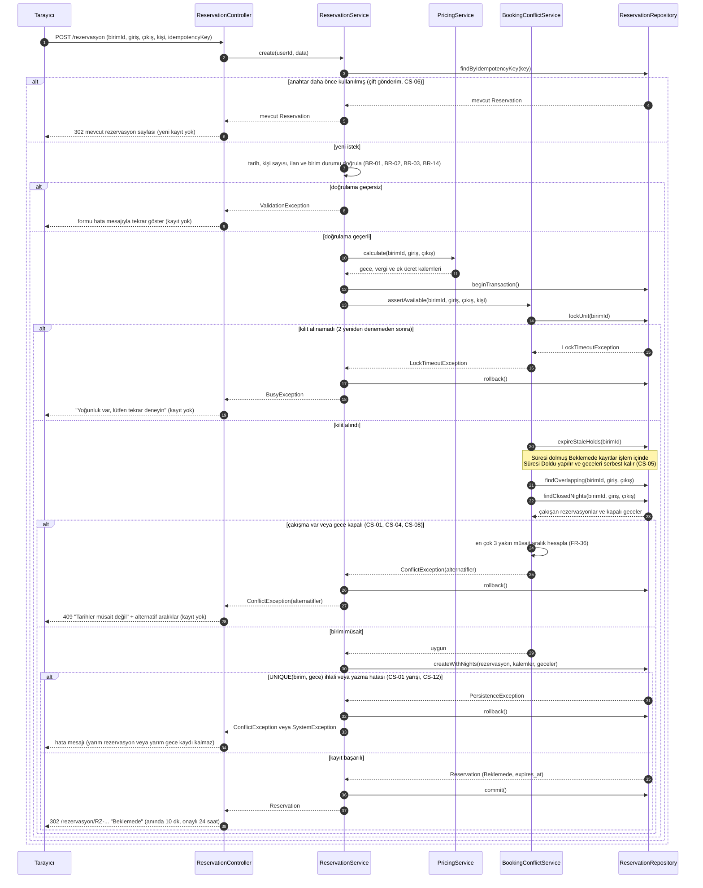

<<<<<<< HEAD
# Tasarım Dokümanı: Otel / Kiralık Ev Rezervasyon Sistemi

## 1. Mimari

Her istek aynı yoldan geçer: `public/index.php` → Router → Controller → Service → Repository. Her katmanın tek bir görevi vardır ve bir katman yalnızca altındaki katmanı çağırır.

| Katman | Görevi | Asla yapmaz | Otel rezervasyon örneği |
|---|---|---|---|
| Router | Adrese göre hangi controller metodunun çalışacağını seçer | İş kuralı içermez | `POST /rezervasyon` → `ReservationController::store` |
| Controller | `$_POST/$_GET` verisini alır, servisi çağırır, görünümü seçer | SQL yazmaz, hesap yapmaz | `ReservationController` |
| Service | İş kuralları ve çekirdek algoritma | `$_POST` okumaz, HTML üretmez | `AvailabilityService::isAvailable` (çakışma), `PricingService::quote` (gecelik döküm), `CancellationService::refund` |
| Repository | Veriyi okur ve yazar | İş kuralı içermez | `ReservationRepositoryInterface` |
| Model | Veriyi taşıyan sade sınıf | Veritabanına erişmez | `Reservation`, `Property` |
| View | HTML gösterir, çıktıyı kaçışlar | Hesap yapmaz, veri çekmez | `views/reservations/form.php` |

**Çekirdek problem:** Tarih çakışması ve çift rezervasyonun önlenmesi (`AvailabilityService`), sezonluk dinamik fiyat (`PricingService`, Strategy deseni) ve iptal/iade hesabı (`CancellationService`).

### Klasör yapısı

```
ev-otel-rezervasyon/
├── public/
│   └── index.php
├── src/
│   ├── Router.php
│   ├── Controller/      (Auth, Property, Reservation, Profile, Host, Review,
│   │                     Complaint, Admin, Api)
│   ├── Service/         (Auth, Availability, Property, Reservation, Pricing,
│   │   │                 Cancellation, Favorite, Review, Notification, Complaint,
│   │   │                 User, Report, ImageUpload)
│   │   └── Pricing/     (Weekend, Season, LongStayDiscount stratejileri)
│   ├── Repository/
│   │   ├── *Interface.php
│   │   ├── Json/        (Aşama 2)
│   │   └── Pdo/         (Aşama 3)
│   └── Model/           (User, RoomType, Property, Photo, Amenity, PriceRule,
│                         Availability, Reservation, Cancellation, Review,
│                         Favorite, Notification, Complaint)
├── views/
├── database/
├── tests/
├── docs/
└── storage/
```

**Kontrol sorusu:** Veritabanını değiştirirsek yalnızca `src/Repository/Pdo/` altındaki sınıflar değişir.
=======
01.ana-sayfa.png
02.arama-sonuclari.png
03.ilan-detay-rezervasyon.png
04.rezervasyon-özeti.png
05.giris-kayit.png

use case kodu mermaid ile
## 2. Sınıf Diyagramı

Diyagram, çekirdek akışı gösterir: rezervasyon oluşturma, çakışma kontrolü, Strategy ile gecelik fiyat hesabı, iptal ve iade. Controller yalnızca Service'i, Service yalnızca Repository arayüzünü çağırır.


### Diyagramın okunuşu
- **Strategy:** `PricingService`, fiyat kurallarını `PricingStrategyInterface` üzerinden çalıştırır. Yeni kural eklemek yeni bir sınıf eklemektir.
- **Repository:** Servisler yalnızca `...RepositoryInterface` bilir. JSON (Aşama 2) ve PDO (Aşama 3) uygulamaları aynı arayüzü uygular.
- **Çekirdek problem:** `AvailabilityService::isAvailable`, `findOverlapping` ile çakışmaları arar. Aynı gün çıkış-giriş çakışma sayılmaz.
## 4. ER Diyagramı
 

 
### Normalizasyon Gerekçesi
 
Her varlık kendi tablosunda tutulmuş, tekrarlayan veriler (fotoğraf, olanak, gece, fiyat kalemi, favori) ara veya alt tablolara ayrılarak **1NF** sağlanmıştır. Bileşik anahtarlı tablolarda (`PROPERTY_AMENITIES`, `FAVORITES`, `RESERVATION_NIGHTS`) yalnızca anahtarın tamamına bağlı sütunlar bırakıldığı için **2NF** sağlanır. Müşteri, ilan veya şehir gibi bilgiler yalnızca bir tabloda tutulur ve diğer tablolar bunlara FK ile bağlanır; böylece anahtar olmayan sütunlar arasında geçişli bağımlılık kalmaz ve **3NF** sağlanır.
 
**Bilinçli iki istisna:**
 
1. `RESERVATION_NIGHTS.unit_id`: Kesin 3NF'ye göre fazlalıktır; ancak veritabanının `UNIQUE (unit_id, night_date)` kısıtını uygulayabilmesi için gereklidir. Bu kısıt çift rezervasyona karşı son savunmadır. Tutarsızlığı `(reservation_id, unit_id)` bileşik FK'si önler.
2. `RESERVATIONS.total_price`: `RESERVATION_CHARGES` toplamından türetilebilir; ancak fiyat anlık görüntüsü olarak bilinçli saklanır (BR-16) ve testle kalemlerin toplamına eşitliği doğrulanır.


## 3. Sıralama Diyagramı: Rezervasyon Oluşturma (Çekirdek: Çift Rezervasyon Önleme)
 

 
### Diyagramdaki durumlar
 
| Dal | Senaryo | Sonuç |
| --- | --- | --- |
| Başarılı | Birim müsait, kayıt ve geceler tek işlemde yazıldı | Rezervasyon Beklemede olur, geceler tutulur |
| Hata 1 | Çift gönderim (CS-06) | Yeni kayıt oluşmaz, mevcut rezervasyon gösterilir |
| Hata 2 | Geçersiz tarih, kapasite aşımı, pasif ilan | ValidationException, kayıt yok |
| Hata 3 | Kilit alınamadı | 2 deneme sonrası "yoğunluk" mesajı, kayıt yok |
| Hata 4 | Çakışma veya kapalı gece (CS-01, 04, 08) | ConflictException, en çok 3 alternatif önerilir |
| Hata 5 | UNIQUE(birim, gece) ihlali veya yazma hatası (CS-12) | Rollback, yarım kayıt kalmaz |


5. Tasarım Desenleri
5.1 Repository Deseni (Zorunlu)
1. Problem: Projede kullanıcı, ilan, müsaitlik, rezervasyon, ödeme, yorum, favori, bildirim ve şikâyet olmak üzere çok sayıda kalıcı veri varlığı vardır. Veriye erişim kodu (SQL, dosya okuma) doğrudan servis sınıflarının içine yazılırsa, Aşama 2'de JSON dosyalarıyla Aşama 3'te MySQL ile çalışmak istendiğinde tüm iş mantığı kodunun değişmesi gerekir.

2. Desen: Repository deseni; UserRepositoryInterface, PropertyRepositoryInterface, ReservationRepositoryInterface, AvailabilityRepositoryInterface, ReviewRepositoryInterface gibi arayüzler ve bunların MySql*Repository (Aşama 3) ile Json*Repository (Aşama 2) somut uygulamalarıyla kurulur. Servis sınıfları (ReservationService, AvailabilityService, PricingService) yalnızca arayüzü tanır; gerçek veritabanı sınıfını bilmez.

3. Alternatif: Servis sınıflarının içinde doğrudan PDO veya file_get_contents() çağrıları yapmak; yani katmansız, veri erişimi ile iş kuralını aynı sınıfta toplamak.

4. Neden: Depolama katmanı değiştiğinde (JSON → MySQL) yalnızca yeni bir MySql*Repository sınıfı yazılır; ReservationService ve AvailabilityService içindeki çekirdek iş kuralı (tarih çakışma kontrolü) hiç değişmez. Bu, SRS'teki NFR-08 (Bakım yapılabilirlik) ve FR-18 (çift rezervasyon engeli) gereksinimlerinin sürdürülebilir biçimde karşılanmasını sağlar.

5.2 Strategy Deseni (Fiyatlandırma)
1. Problem: SRS'teki FR-22, ilan sahibinin tarih aralığına göre fiyat tanımlamasını; FR-14 ise gecelik fiyat ile vergi/ek ücretlerin ayrı ayrı hesaplanmasını zorunlu kılar. Aynı ilan için hafta sonu farklı fiyat, yüksek sezon farklı fiyat, uzun konaklamada indirim uygulanabilir. Bu kuralların tümünü PricingService içinde if ($tarih hafta sonu mu) ... elseif ($sezon mu) ... elseif ($gece > 7) ... zinciriyle yazmak hem okunması zor hem de yeni bir kural (örneğin "son dakika indirimi") eklendiğinde mevcut çalışan kodu bozar.

2. Desen: Strategy deseni; PricingStrategyInterface arayüzü ile WeekendPricingStrategy, SeasonalPricingStrategy ve LongStayDiscountStrategy somut strateji sınıfları üzerinden uygulanır. PricingService::calculate(int roomTypeId, string checkIn, string checkOut) metodu, PriceRuleRepositoryInterface'ten gelen kurallara bakarak çalışma anında uygun stratejiyi (setStrategy()) seçer ve fiyat dökümünü dizi olarak döner. Sınıf diyagramında bu ilişki PricingService --> PricingStrategyInterface ve WeekendPricingStrategy ..|> PricingStrategyInterface olarak gösterilmiştir.

3. Alternatif: Tek bir PricingService sınıfı içinde iç içe if/elseif bloklarıyla tüm fiyat kurallarını yönetmek; yani desensiz, tek sorumluluk ilkesini bozan çözüm.

4. Neden: Yeni bir fiyat kuralı (örneğin "bayram dönemi zammı" veya "erken rezervasyon indirimi") eklemek için mevcut PricingService veya diğer strateji sınıflarına dokunmadan yalnızca yeni bir sınıf (HolidayPricingStrategy) yazıp arayüzü uygulamak yeterlidir. Bu, Açık/Kapalı Prensibi'ne (OCP) uygundur; ayrıca her strateji bağımsız olarak birim testine tabi tutulabildiği için SRS'teki AC-08 (toplam fiyatın onay öncesi açık gösterimi) ve kılavuzdaki "en az 10 PHPUnit testi" şartı daha güvenilir biçimde karşılanır. Sunumda "Hangi sınıflar bu deseni oluşturuyor?" sorusuna PricingStrategyInterface ile üç somut strateji sınıfı diyagr

6 risk tablosu
[risk-listesi.xlsx](https://github.com/user-attachments/files/33447133/risk-listesi.xlsx)
