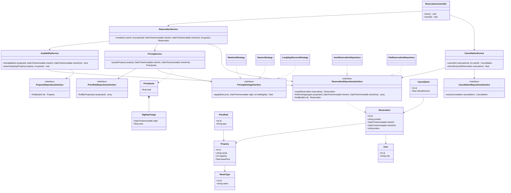
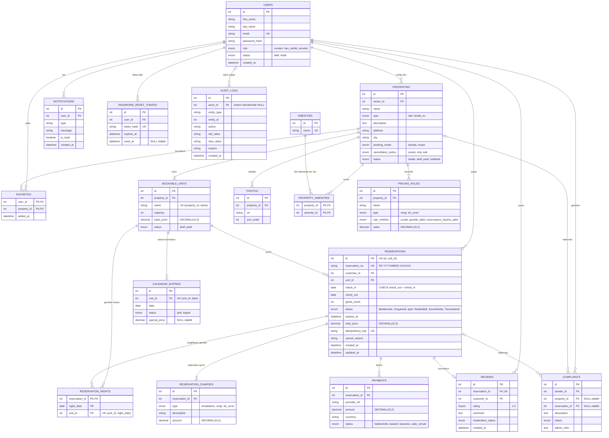
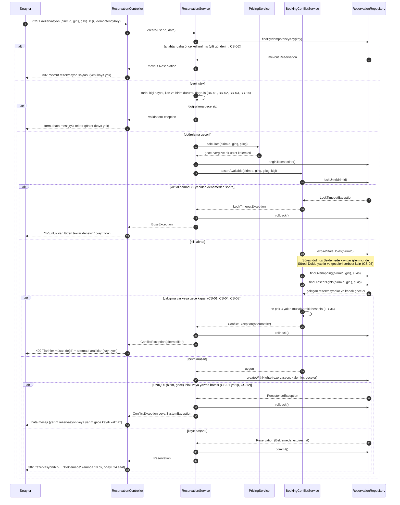
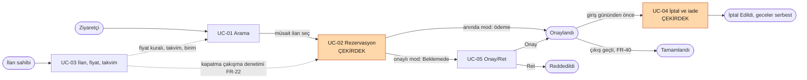
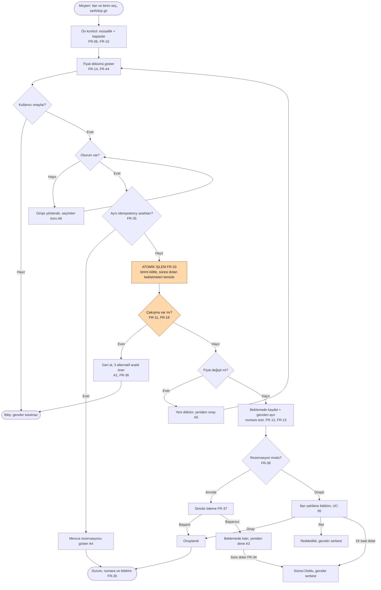

<<<<<<< HEAD
# Tasarım Dokümanı: Otel / Kiralık Ev Rezervasyon Sistemi

## 1. Mimari

Her istek aynı yoldan geçer: `public/index.php` → Router → Controller → Service → Repository. Her katmanın tek bir görevi vardır ve bir katman yalnızca altındaki katmanı çağırır.

| Katman | Görevi | Asla yapmaz | Otel rezervasyon örneği |
|---|---|---|---|
| Router | Adrese göre hangi controller metodunun çalışacağını seçer | İş kuralı içermez | `POST /rezervasyon` → `ReservationController::store` |
| Controller | `$_POST/$_GET` verisini alır, servisi çağırır, görünümü seçer | SQL yazmaz, hesap yapmaz | `ReservationController` |
| Service | İş kuralları ve çekirdek algoritma | `$_POST` okumaz, HTML üretmez | `AvailabilityService::isAvailable` (çakışma), `PricingService::quote` (gecelik döküm), `CancellationService::refund` |
| Repository | Veriyi okur ve yazar | İş kuralı içermez | `ReservationRepositoryInterface` |
| Model | Veriyi taşıyan sade sınıf | Veritabanına erişmez | `Reservation`, `Property` |
| View | HTML gösterir, çıktıyı kaçışlar | Hesap yapmaz, veri çekmez | `views/reservations/form.php` |

**Çekirdek problem:** Tarih çakışması ve çift rezervasyonun önlenmesi (`AvailabilityService`), sezonluk dinamik fiyat (`PricingService`, Strategy deseni) ve iptal/iade hesabı (`CancellationService`).

### Klasör yapısı

```
ev-otel-rezervasyon/
├── public/
│   └── index.php
├── src/
│   ├── Router.php
│   ├── Controller/      (Auth, Property, Reservation, Profile, Host, Review,
│   │                     Complaint, Admin, Api)
│   ├── Service/         (Auth, Availability, Property, Reservation, Pricing,
│   │   │                 Cancellation, Favorite, Review, Notification, Complaint,
│   │   │                 User, Report, ImageUpload)
│   │   └── Pricing/     (Weekend, Season, LongStayDiscount stratejileri)
│   ├── Repository/
│   │   ├── *Interface.php
│   │   ├── Json/        (Aşama 2)
│   │   └── Pdo/         (Aşama 3)
│   └── Model/           (User, RoomType, Property, Photo, Amenity, PriceRule,
│                         Availability, Reservation, Cancellation, Review,
│                         Favorite, Notification, Complaint)
├── views/
├── database/
├── tests/
├── docs/
└── storage/
```

**Kontrol sorusu:** Veritabanını değiştirirsek yalnızca `src/Repository/Pdo/` altındaki sınıflar değişir.
=======
01.ana-sayfa.png
02.arama-sonuclari.png
03.ilan-detay-rezervasyon.png
04.rezervasyon-özeti.png
05.giris-kayit.png

use case kodu mermaid ile
## 2. Sınıf Diyagramı

Diyagram, çekirdek akışı gösterir: rezervasyon oluşturma, çakışma kontrolü, Strategy ile gecelik fiyat hesabı, iptal ve iade. Controller yalnızca Service'i, Service yalnızca Repository arayüzünü çağırır.



### Diyagramın okunuşu
- **Strategy:** `PricingService`, fiyat kurallarını `PricingStrategyInterface` üzerinden çalıştırır. Yeni kural eklemek yeni bir sınıf eklemektir.
- **Repository:** Servisler yalnızca `...RepositoryInterface` bilir. JSON (Aşama 2) ve PDO (Aşama 3) uygulamaları aynı arayüzü uygular.
- **Çekirdek problem:** `AvailabilityService::isAvailable`, `findOverlapping` ile çakışmaları arar. Aynı gün çıkış-giriş çakışma sayılmaz.
## 3. ER Diyagramı
 

 
### Normalizasyon Gerekçesi
 
Her varlık kendi tablosunda tutulmuş, tekrarlayan veriler (fotoğraf, olanak, gece, fiyat kalemi, favori) ara veya alt tablolara ayrılarak **1NF** sağlanmıştır. Bileşik anahtarlı tablolarda (`PROPERTY_AMENITIES`, `FAVORITES`, `RESERVATION_NIGHTS`) yalnızca anahtarın tamamına bağlı sütunlar bırakıldığı için **2NF** sağlanır. Müşteri, ilan veya şehir gibi bilgiler yalnızca bir tabloda tutulur ve diğer tablolar bunlara FK ile bağlanır; böylece anahtar olmayan sütunlar arasında geçişli bağımlılık kalmaz ve **3NF** sağlanır.
 
**Bilinçli iki istisna:**
 
1. `RESERVATION_NIGHTS.unit_id`: Kesin 3NF'ye göre fazlalıktır; ancak veritabanının `UNIQUE (unit_id, night_date)` kısıtını uygulayabilmesi için gereklidir. Bu kısıt çift rezervasyona karşı son savunmadır. Tutarsızlığı `(reservation_id, unit_id)` bileşik FK'si önler.
2. `RESERVATIONS.total_price`: `RESERVATION_CHARGES` toplamından türetilebilir; ancak fiyat anlık görüntüsü olarak bilinçli saklanır (BR-16) ve testle kalemlerin toplamına eşitliği doğrulanır.


## 4. Sıralama Diyagramı: Rezervasyon Oluşturma (Çekirdek: Çift Rezervasyon Önleme)
 

 
### Diyagramdaki durumlar
 
| Dal | Senaryo | Sonuç |
| --- | --- | --- |
| Başarılı | Birim müsait, kayıt ve geceler tek işlemde yazıldı | Rezervasyon Beklemede olur, geceler tutulur |
| Hata 1 | Çift gönderim (CS-06) | Yeni kayıt oluşmaz, mevcut rezervasyon gösterilir |
| Hata 2 | Geçersiz tarih, kapasite aşımı, pasif ilan | ValidationException, kayıt yok |
| Hata 3 | Kilit alınamadı | 2 deneme sonrası "yoğunluk" mesajı, kayıt yok |
| Hata 4 | Çakışma veya kapalı gece (CS-01, 04, 08) | ConflictException, en çok 3 alternatif önerilir |
| Hata 5 | UNIQUE(birim, gece) ihlali veya yazma hatası (CS-12) | Rollback, yarım kayıt kalmaz |


5. Tasarım Desenleri
   
5.1 Repository Deseni (Zorunlu)
1. Problem: Projede kullanıcı, ilan, müsaitlik, rezervasyon, ödeme, yorum, favori, bildirim ve şikâyet olmak üzere çok sayıda kalıcı veri varlığı vardır. Veriye erişim kodu (SQL, dosya okuma) doğrudan servis sınıflarının içine yazılırsa, Aşama 2'de JSON dosyalarıyla Aşama 3'te MySQL ile çalışmak istendiğinde tüm iş mantığı kodunun değişmesi gerekir.

2. Desen: Repository deseni; UserRepositoryInterface, PropertyRepositoryInterface, ReservationRepositoryInterface, AvailabilityRepositoryInterface, ReviewRepositoryInterface gibi arayüzler ve bunların MySql*Repository (Aşama 3) ile Json*Repository (Aşama 2) somut uygulamalarıyla kurulur. Servis sınıfları (ReservationService, AvailabilityService, PricingService) yalnızca arayüzü tanır; gerçek veritabanı sınıfını bilmez.

3. Alternatif: Servis sınıflarının içinde doğrudan PDO veya file_get_contents() çağrıları yapmak; yani katmansız, veri erişimi ile iş kuralını aynı sınıfta toplamak.

4. Neden: Depolama katmanı değiştiğinde (JSON → MySQL) yalnızca yeni bir MySql*Repository sınıfı yazılır; ReservationService ve AvailabilityService içindeki çekirdek iş kuralı (tarih çakışma kontrolü) hiç değişmez. Bu, SRS'teki NFR-08 (Bakım yapılabilirlik) ve FR-18 (çift rezervasyon engeli) gereksinimlerinin sürdürülebilir biçimde karşılanmasını sağlar.

5.2 Strategy Deseni (Fiyatlandırma)
1. Problem: SRS'teki FR-22, ilan sahibinin tarih aralığına göre fiyat tanımlamasını; FR-14 ise gecelik fiyat ile vergi/ek ücretlerin ayrı ayrı hesaplanmasını zorunlu kılar. Aynı ilan için hafta sonu farklı fiyat, yüksek sezon farklı fiyat, uzun konaklamada indirim uygulanabilir. Bu kuralların tümünü PricingService içinde if ($tarih hafta sonu mu) ... elseif ($sezon mu) ... elseif ($gece > 7) ... zinciriyle yazmak hem okunması zor hem de yeni bir kural (örneğin "son dakika indirimi") eklendiğinde mevcut çalışan kodu bozar.

2. Desen: Strategy deseni; PricingStrategyInterface arayüzü ile WeekendPricingStrategy, SeasonalPricingStrategy ve LongStayDiscountStrategy somut strateji sınıfları üzerinden uygulanır. PricingService::calculate(int roomTypeId, string checkIn, string checkOut) metodu, PriceRuleRepositoryInterface'ten gelen kurallara bakarak çalışma anında uygun stratejiyi (setStrategy()) seçer ve fiyat dökümünü dizi olarak döner. Sınıf diyagramında bu ilişki PricingService --> PricingStrategyInterface ve WeekendPricingStrategy ..|> PricingStrategyInterface olarak gösterilmiştir.

3. Alternatif: Tek bir PricingService sınıfı içinde iç içe if/elseif bloklarıyla tüm fiyat kurallarını yönetmek; yani desensiz, tek sorumluluk ilkesini bozan çözüm.

4. Neden: Yeni bir fiyat kuralı (örneğin "bayram dönemi zammı" veya "erken rezervasyon indirimi") eklemek için mevcut PricingService veya diğer strateji sınıflarına dokunmadan yalnızca yeni bir sınıf (HolidayPricingStrategy) yazıp arayüzü uygulamak yeterlidir. Bu, Açık/Kapalı Prensibi'ne (OCP) uygundur; ayrıca her strateji bağımsız olarak birim testine tabi tutulabildiği için SRS'teki AC-08 (toplam fiyatın onay öncesi açık gösterimi) ve kılavuzdaki "en az 10 PHPUnit testi" şartı daha güvenilir biçimde karşılanır. Sunumda "Hangi sınıflar bu deseni oluşturuyor?" sorusuna PricingStrategyInterface ile üç somut strateji sınıfı diyagr


6 risk tablosu
| Kimlik | Risk | Kategori | Olasılık | Etki | Olasılık Puanı | Etki Puanı | Risk Skoru | Seviye | Önlem | İlgili Test / Gereksinim | Kaynak |
| :--- | :--- | :--- | :--- | :--- | :---: | :---: | :---: | :---: | :--- | :--- | :--- |
| **R1** | Eş zamanlı isteklerde "önce kontrol et, sonra kaydet" yarışı yüzünden çift rezervasyon oluşması | Çekirdek | Orta | Yüksek | 2 | 3 | 6 | Yüksek | Transaction + birim satırı kilidi (SELECT ... FOR UPDATE) + UNIQUE(birim, gece) kısıtı. T-05 (50 paralel istek) ve T-06 testleri. | T-05, T-06, FR-18, FR-33 | SRS 4.9 |
| **R2** | Sınır günü hatası: çıkış gününün gece sayıp sayılmaması | Çekirdek | Yüksek | Yüksek | 3 | 3 | 9 | Yüksek | Yarı açık aralık [giriş, çıkış] tek tanımı. Tüm kodda tek karşılaştırma fonksiyonu. Veri güdümlü T-01 testi (8 durum). | T-01, BR-11, BR-13 | SRS 4.9 |
| **R3** | Arama ve rezervasyonun farklı kural uygulaması (aramada görünen ama rezervasyonda reddedilen birim) | Çekirdek | Orta | Orta | 2 | 2 | 4 | Orta | Kuralın tek kopyası. AvailabilityService kuralı kendisi yazmaz, bu servisi kullanır. T-08 tutarlılık testi. | T-08, FR-06, FR-10, FR-11 | SRS 4.9 |
| **R4** | Süresi dolmuş "hayalet" bekletmelerin geceleri gereksiz yere bloke etmesi | Çekirdek | Orta | Orta | 2 | 2 | 4 | Orta | Lazy expiry (çalışma kontrolü sırasında temizleme) + dakikada bir çalışan zamanlanmış görev. T-03 testi. | T-03, FR-34, CS-05 | SRS 4.9 |
| **R5** | Aşama 2'deki JSON depoda eşzamanlı yazmayla dosya bozulması veya çift kayıt | Çekirdek | Orta | Yüksek | 2 | 3 | 6 | Yüksek | flock(LOCK_EX) altında tek kritik bölüm. Önce geçici dosyaya yazıp yeniden adlandırma. T-10 testi. | T-10, SRS 4.5 | SRS 4.9 |
| **R6** | Yarım kayıt: rezervasyon yazıldıktan sonra gece kaydı eklenirken hata veya sunucu kesintisi | Çekirdek | Düşük | Yüksek | 1 | 3 | 3 | Orta | Rezervasyon, gece and kalemler tek atomik işlemde yazılır (createWithNights). Hata durumunda rollback(). T-07 hata enjeksiyon testi. | T-07, FR-33, CS-12 | SRS 4.6 (CS-12) |
| **R7** | Yapay zekâ üretimi kodun çakışma kontrolünü Controller'a veya yanlış katmana koyması | Çekirdek | Yüksek | Orta | 3 | 2 | 6 | Yüksek | Her istemde mimari tablo ve SRS Bölüm 4.7 bağlam olarak verilir. PR incelemesinde katman kuralı kontrol edilir (Controller $\rightarrow$ Repository oku yok). | SRS 4.7, katmanlı mimari | SRS 4.9 |
| **R8** | Kapsamın büyümesi (42 FR, çok sayıda varlık, kısıtlı süre) | Genel | Yüksek | Orta | 3 | 2 | 6 | Yüksek | Backlog'ta önce çekirdek etiketli işler. SRS'deki kapsam dışı listesine (overbooking, kanal yöneticisi, gerçek ödeme) sadık kalmak. | SRS 4.1, SRS 11.2 | Kılavuz (projeye uyarlandı) |
| **R9** | Bir üyenin katkı vermemesi (4 kişilik ekip, 4 rol) | Genel | Orta | Yüksek | 2 | 3 | 6 | Yüksek | Her issue'ya sorumlu atamak, haftalık toplantı, sorunu erken bildirmek, panoda Group by Assignees ile iş dağılımını izlemek. | GitHub Projects backlog | Kılavuz |
| **R10** | Aynı dosyada çakışan değişiklikler (Git) | Genel | Yüksek | Düşük | 3 | 1 | 3 | Orta | Dal + pull request, main için onay zorunluluğu, işleri dosya bazında bölmek. | Git dal ve PR akışı | Kılavuz |
| **R11** | Ortam sorunları (PHP sürümü, Composer, MySQL) | Genel | Düşük | Orta | 1 | 2 | 2 | Düşük | İlk hafta kurulum ve doğrulama (composer install). Sorun olursa Laragon. PHP >= 8.2 sürümünün herkeste aynı olduğunu kontrol etmek. | Adım 0: Composer kurulumu | Kılavuz |
| **R12** | Süre, limit ve iade oranı gibi sayısal kararların onaysız olması | Genel | Orta | Orta | 2 | 2 | 4 | Orta | Ekip içinde doğrulama toplantısı, ders yürütücüsüyle onay, değerlerin tek yerde (yapılandırma) tutulması. | SRS 11.4 | SRS 11.4 (varsayımlar) |


7 Use Case diyagramı
```mermaid
graph LR
    sub5["Otel / Kiralık Ev Rezervasyon Sistemi"]
        UC01["UC-01: Konaklama arama"]
        UC02["UC-02: Rezervasyon oluşturma"]
        UC03["UC-03: İlan, fiyat, takvim"]
        UC04["UC-04: İptal ve iade"]
        UC05["UC-05: Talep onay / ret"]
        UC06["UC-06: Üyelik ve giriş"]
        UC07["UC-07: Rezervasyon ve profil"]
        UC08["UC-08: Yorum ve şikâyet"]
        UC09["UC-09: Yönetici denetimi"]
        UC10["UC-10: Doluluk / gelir raporu"]
        UC11["UC-11: Otomatik durum geçişi"]
    end

    Ziyaretci([Ziyaretçi])
    Musteri([Müşteri])
    IlanSahibi([İlan sahibi])
    Yonetici([Yönetici])
    Sistem([Sistem / zamanlı görev])

    Musteri --> Ziyaretci

    Ziyaretci --- UC01
    Ziyaretci --- UC06

    Musteri --- UC01
    Musteri --- UC02
    Musteri --- UC04
    Musteri --- UC06
    Musteri --- UC07
    Musteri --- UC08

    IlanSahibi --- UC03
    IlanSahibi --- UC05
    IlanSahibi --- UC10

    Yonetici --- UC09
    Sistem --- UC11
 
8 arayüz Sayfa haritası
```mermaid
 flowchart LR
subgraph HER["Herkes (ziyaretçi dahil)"]
  A["Ana sayfa ve arama"] --> B["Arama sonuçları"]
  B --> C["İlan detayı ve aylık takvim"]
  G["Giriş"]
  K["Kayıt ol"]
  PW["Parola sıfırlama"]
end
subgraph MUS["Kayıtlı müşteri"]
  D["Rezervasyon onayı ve gecelik fiyat dökümü"] --> E["Rezervasyonlarım"]
  E --> F["İptal önizleme ve iade"]
  E --> Y["Yorum yaz"]
  H["Favoriler"]
  I["Profil"]
  BL["Bildirimler"]
  SK["Şikâyet oluştur"]
end
subgraph ILN["İlan sahibi (yalnızca ilan sahibi)"]
  J["İlan sahibi paneli"] --> L1["İlanlarım ve odalar"]
  L1 --> RS["Resim yükleme"]
  J --> TK["Takvim ve fiyat kuralları"]
  J --> GR["Gelen rezervasyonlar: onayla / reddet"]
  J --> RP["Doluluk ve gelir raporu"]
end
subgraph YON["Yönetici (yalnızca yönetici)"]
  O["Yönetici paneli"] --> KU["Kullanıcılar"]
  O --> IL["İlanlar: inceleme ve kaldırma"]
  O --> SC["Şikâyetler"]
  O --> YD["Yorum denetimi"]
  O --> YR["Raporlar"]
end
G --> A
K --> G
G -.-> PW
C -->|"giriş gerekir"| D
A --> H
A --> I
A --> BL
C -.-> SK
G -->|"ilan sahibi rolü"| J
G -->|"yönetici rolü"| O
classDef her fill:#eef2f7,stroke:#5b6b82,color:#1b2430
classDef mus fill:#e3f1e8,stroke:#3d8b5a,color:#12301f
classDef iln fill:#fdf0d9,stroke:#b9852a,color:#3a2a08
classDef yon fill:#f9e1e1,stroke:#b04a4a,color:#3a1010
class A,B,C,G,K,PW her
class D,E,F,Y,H,I,BL,SK mus
class J,L1,RS,TK,GR,RP iln
class O,KU,IL,SC,YD,YR yon
style HER fill:#f7f9fc,stroke:#c3ccd8,color:#1b2430
style MUS fill:#f4faf6,stroke:#b9dcc6,color:#12301f
style ILN fill:#fffaf0,stroke:#ecd5a6,color:#3a2a08
style YON fill:#fdf6f6,stroke:#e6c0c0,color:#3a1010
```

Renkler rolü gösterir: gri = herkes, yeşil = kayıtlı müşteri, turuncu = yalnızca ilan sahibi, kırmızı = yalnızca yönetici. Yetki sunucu tarafında da denetlenir (NFR-03).

Yönetici (yalnızca yönetici)
İlan sahibi (yalnızca ilan sahibi)
Kayıtlı müşteri
Herkes (ziyaretçi dahil)
giriş gerekir
ilan sahibi rolü
yönetici rolü
Ana sayfa ve arama
Arama sonuçları
İlan detayı ve aylık takvim
Giriş
Kayıt ol
Parola sıfırlama
Rezervasyon onayı vegecelik fiyat dökümü
Rezervasyonlarım
İptal önizleme ve iade
Yorum yaz
Favoriler
Profil
Bildirimler
Şikâyet oluştur
İlan sahibi paneli
İlanlarım ve odalar
Resim yükleme
Takvim ve fiyat kuralları
Gelen rezervasyonlar:onayla / reddet
Doluluk ve gelir raporu
Yönetici paneli
Kullanıcılar
İlanlar: inceleme ve kaldırma
Şikâyetler
Yorum denetimi
Raporlar
7.2 Ekran taslakları

## 9  izlenebilirlik matrisi

Eşleme, SRS’teki FR kartlarının “Olay/Kullanım Senaryosu” ve “Destekleyici Materyal” alanlarından çıkarıldı (Ek B ile uyumlu). Turuncu işaret ÇEKİRDEK gereksinimdir.

| UC | Senaryo | FR sayısı | Çekirdek FR | AC sayısı | Test sayısı |
| --- | --- | --- | --- | --- | --- |
| **UC-01** | Konaklama Arama | 5 | 3 | 4 | 3 |
| **UC-02** | Rezervasyon Oluşturma | 15 | 11 | 16 | 10 |
| **UC-03** | İlan/Fiyat/Takvim Yönetimi | 7 | 2 | 6 | 2 |
| **UC-04** | İptal ve İade | 5 | 4 | 5 | 2 |
| **UC-05** | Talep Onay/Ret | 4 | 2 | 2 | 1 |

| FR | Öncelik | UC-01 | UC-02 | UC-03 | UC-04 | UC-05 | BR | AC | Test | Tasarım bileşeni |
| --- | --- | --- | --- | --- | --- | --- | --- | --- | --- | --- |
| **FR-01** | Zorunlu |  |  |  |  |  |  | 01 |  | AuthController → AuthService |
| **FR-02** | Zorunlu |  |  |  |  |  |  |  |  | AuthController → AuthService |
| **FR-03** | Zorunlu |  |  |  |  |  |  |  |  | AuthController → AuthService |
| **FR-04** | Gerekli |  |  |  |  |  |  |  |  | AuthController → AuthService |
| **FR-05** | Zorunlu |  |  |  |  |  |  | 06, 07 |  | AuthController → AuthService |
| **FR-06** | Çekirdek | ● |  |  |  |  | BR-01, BR-02, BR-14 | 02, 20 | T-08 | PropertyController → AvailabilityService |
| **FR-07** | Gerekli | ● |  |  |  |  |  | 29 |  | PropertyController → PropertyService |
| **FR-08** | Gerekli | ● |  |  |  |  |  |  |  | PropertyController → PropertyService |
| **FR-09** | Zorunlu |  |  |  |  |  | BR-06 |  |  | PropertyController → PropertyService |
| **FR-10** | Çekirdek | ● | ● |  |  |  |  | 32 | T-08 | PropertyController → AvailabilityService |
| **FR-44** | Çekirdek | ● | ● |  |  |  | BR-23, BR-26 |  | T-12, T-13 | PropertyController → PricingService |
| **FR-11** | Çekirdek |  | ● |  |  |  |  | 12 | T-05 | ReservationController → BookingConflictService |
| **FR-12** | Çekirdek |  | ● |  |  |  | BR-05, BR-15 |  |  | ReservationController → ReservationService |
| **FR-13** | Zorunlu |  | ● |  |  |  |  | 04 |  | ReservationController → ReservationService |
| **FR-18** | Çekirdek |  | ● |  |  |  | BR-11, BR-12, BR-13 | 05, 13, 22 | T-05, T-06, T-11 | ReservationController → BookingConflictService |
| **FR-33** | Çekirdek |  | ● |  |  |  |  | 12 | T-07 | ReservationService → BookingConflictService |
| **FR-34** | Çekirdek |  | ● |  |  |  | BR-15 | 15 | T-03 | ReservationService → BookingConflictService |
| **FR-35** | Çekirdek |  | ● |  |  |  |  | 17 | T-04 | ReservationController → ReservationService |
| **FR-36** | Çekirdek |  | ● |  |  |  |  | 12 |  | ReservationController → BookingConflictService |
| **FR-37** | Zorunlu |  | ● |  |  |  | BR-05 | 19 |  | ReservationController → PaymentService |
| **FR-14** | Çekirdek |  | ● |  |  |  | BR-07, BR-16, BR-23, BR-26 | 08, 21, 23, 24, 25 | T-12, T-13 | ReservationController → PricingService |
| **FR-43** | Çekirdek |  |  | ● |  |  | BR-23, BR-26 | 25 | T-12 | HostController → PricingService |
| **FR-15** | Çekirdek |  | ● |  | ● | ● | BR-12 |  | T-02 | ReservationController → ReservationService |
| **FR-16** | Gerekli |  |  |  |  |  |  | 06 |  | ReservationController → ReservationService |
| **FR-17** | Çekirdek |  |  |  | ● |  | BR-17, BR-18 | 16, 26, 27 | T-02, T-14 | ReservationController → ReservationService |
| **FR-40** | Zorunlu |  |  |  |  |  | BR-09, BR-30 |  |  | Zamanlanmış görev → ReservationService |
| **FR-45** | Çekirdek |  |  |  | ● |  | BR-17, BR-27, BR-28, BR-29 | 26, 27, 28 | T-14 | ReservationController → RefundService |
| **FR-20** | Zorunlu |  |  | ● |  |  |  | 07 |  | HostController → PropertyService |
| **FR-21** | Zorunlu |  |  | ● |  |  | BR-08 | 07 |  | HostController → PropertyService |
| **FR-22** | Çekirdek |  |  | ● |  |  | BR-22 | 18, 25 | T-09 | HostController → AvailabilityService |
| **FR-23** | Çekirdek |  |  |  |  | ● | BR-05, BR-08, BR-15 | 07 |  | HostController → ReservationService |
| **FR-38** | Zorunlu |  |  | ● |  |  | BR-05, BR-17 | 28 |  | HostController → PropertyService |
| **FR-42** | Zorunlu |  |  | ● |  |  | BR-04 | 29 |  | HostController → PropertyService |
| **FR-46** | Gerekli |  |  | ● |  |  |  | 31 |  | HostController → PhotoService |
| **FR-19** | İsteğe bağlı |  |  |  |  |  |  |  |  | ProfileController → FavoriteService |
| **FR-24** | Gerekli |  |  |  |  |  | BR-09, BR-21 |  |  | ReviewController → ReviewService |
| **FR-25** | Gerekli |  |  |  |  |  | BR-10 |  |  | AdminController → ReviewService |
| **FR-26** | Gerekli |  | ● |  | ● | ● |  |  |  | ReservationController → NotificationService |
| **FR-27** | Gerekli |  |  |  |  |  |  |  |  | ComplaintController → ComplaintService |
| **FR-31** | Gerekli |  |  |  |  |  |  |  |  | ProfileController → UserService |
| **FR-32** | Gerekli |  | ● |  |  | ● |  | 06, 07 |  | ReservationController → ReservationService |
| **FR-28** | Gerekli |  |  |  |  |  | BR-10 | 09 |  | AdminController → PropertyService |
| **FR-29** | Gerekli |  |  |  |  |  | BR-10 |  |  | AdminController → UserService |
| **FR-30** | Gerekli |  |  |  |  |  | BR-30 | 30 | T-15 | AdminController → ReportService |
| **FR-39** | Çekirdek |  |  |  | ● |  | BR-10, BR-28 | 09, 27 |  | AdminController → ReservationService |
| **FR-41** | Gerekli |  |  |  |  |  | BR-10 |  |  | AdminController, ReservationService → AuditService |

17 FR hiçbir UC’ye bağlı değil (FR-01–05, 09, 16, 19, 24, 25, 27–31, 40, 41): hesap, profil, yorum, yönetim ve rapor işlevleri. Bunlar için UC yazılmamış, yalnızca US/AC düzeyinde izleniyorlar. İzlenebilirlik açığıdır.

##  10 Akış diyagramları

Genel senaryo akışı



UC-02 Rezervasyon oluşturma (temel akış ve A1–A7 alternatifleri)



## 11 Maliyet-değer grafiği
```mermaid
%%{init: {"quadrantChart": {"chartWidth": 900, "chartHeight": 700, "pointLabelFontSize": 10, "pointTextPadding": 4}}}%%
quadrantChart
    title Gereksinim maliyet-değer grafiği (SRS v2.3)
    x-axis Düşük maliyet --> Yüksek maliyet
    y-axis Düşük değer --> Yüksek değer
    quadrant-1 Stratejik (pahalı, değerli)
    quadrant-2 Önce yap (ucuz, değerli)
    quadrant-3 Fırsat (ucuz, düşük değer)
    quadrant-4 Ertelenebilir (pahalı, düşük değer)
    FR-19: [0.065, 0.100] radius: 6, color: #2563eb
    FR-03: [0.065, 0.420] radius: 6, color: #2563eb
    FR-13: [0.100, 0.420] radius: 6, color: #2563eb
    FR-32: [0.135, 0.420] radius: 6, color: #2563eb
    FR-04: [0.225, 0.260] radius: 6, color: #2563eb
    FR-08: [0.260, 0.260] radius: 6, color: #2563eb
    FR-25: [0.295, 0.260] radius: 6, color: #2563eb
    FR-26: [0.225, 0.225] radius: 6, color: #2563eb
    FR-27: [0.260, 0.225] radius: 6, color: #2563eb
    FR-31: [0.295, 0.225] radius: 6, color: #2563eb
    FR-29: [0.225, 0.190] radius: 6, color: #2563eb
    FR-37: [0.225, 0.420] radius: 6, color: #2563eb
    FR-40: [0.260, 0.420] radius: 6, color: #2563eb
    FR-28: [0.295, 0.420] radius: 6, color: #2563eb
    FR-01: [0.225, 0.580] radius: 6, color: #2563eb
    FR-02: [0.260, 0.580] radius: 6, color: #2563eb
    FR-09: [0.295, 0.580] radius: 6, color: #2563eb
    FR-35: [0.225, 0.545] radius: 6, color: #c2410c
    FR-16: [0.260, 0.545] radius: 6, color: #2563eb
    FR-21: [0.295, 0.545] radius: 6, color: #2563eb
    FR-38: [0.225, 0.510] radius: 6, color: #2563eb
    FR-20: [0.225, 0.740] radius: 6, color: #2563eb
    FR-42: [0.260, 0.740] radius: 6, color: #2563eb
    FR-24: [0.385, 0.260] radius: 6, color: #2563eb
    FR-41: [0.420, 0.260] radius: 6, color: #2563eb
    FR-07: [0.385, 0.420] radius: 6, color: #2563eb
    FR-36: [0.420, 0.420] radius: 6, color: #c2410c
    FR-46: [0.455, 0.420] radius: 6, color: #2563eb
    FR-05: [0.385, 0.580] radius: 6, color: #2563eb
    FR-10: [0.420, 0.580] radius: 6, color: #c2410c
    FR-34: [0.455, 0.580] radius: 6, color: #c2410c
    FR-43: [0.385, 0.545] radius: 6, color: #c2410c
    FR-44: [0.385, 0.740] radius: 6, color: #c2410c
    FR-15: [0.420, 0.740] radius: 6, color: #c2410c
    FR-23: [0.455, 0.740] radius: 6, color: #c2410c
    FR-39: [0.385, 0.705] radius: 6, color: #c2410c
    FR-17: [0.385, 0.900] radius: 6, color: #c2410c
    FR-30: [0.545, 0.420] radius: 6, color: #2563eb
    FR-33: [0.545, 0.740] radius: 6, color: #c2410c
    FR-22: [0.580, 0.740] radius: 6, color: #c2410c
    FR-06: [0.545, 0.900] radius: 6, color: #c2410c
    FR-12: [0.580, 0.900] radius: 6, color: #c2410c
    FR-14: [0.615, 0.900] radius: 6, color: #c2410c
    FR-45: [0.545, 0.865] radius: 6, color: #c2410c
    FR-11: [0.705, 0.900] radius: 6, color: #c2410c
    FR-18: [0.740, 0.900] radius: 6, color: #c2410c
```


