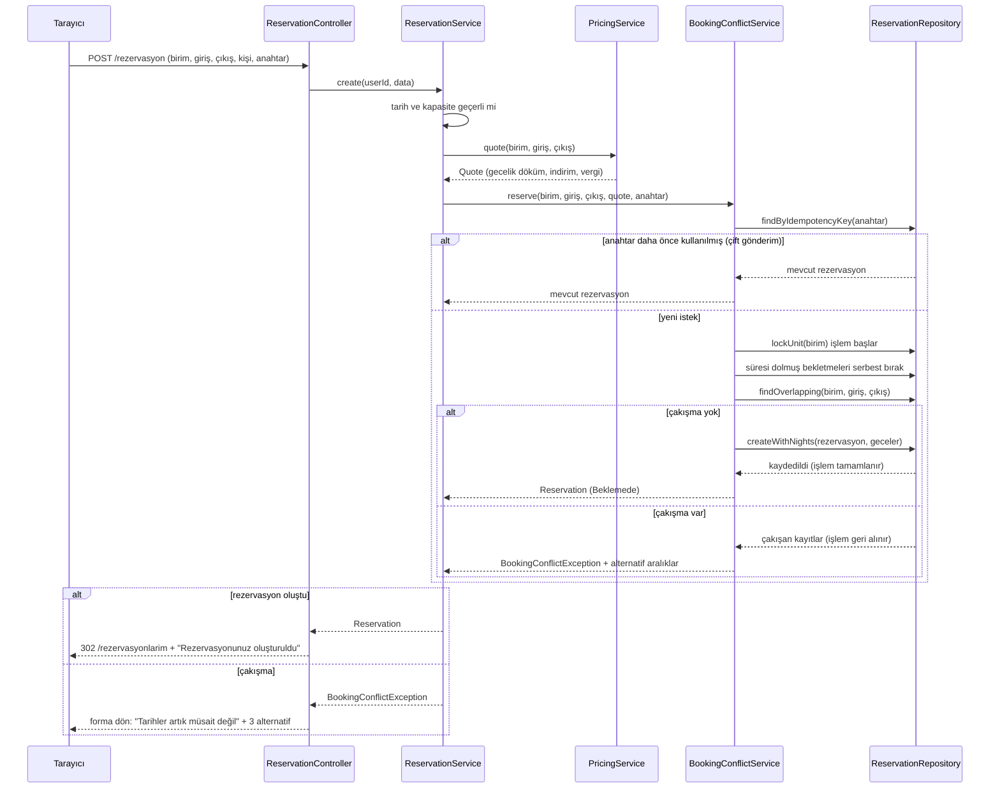
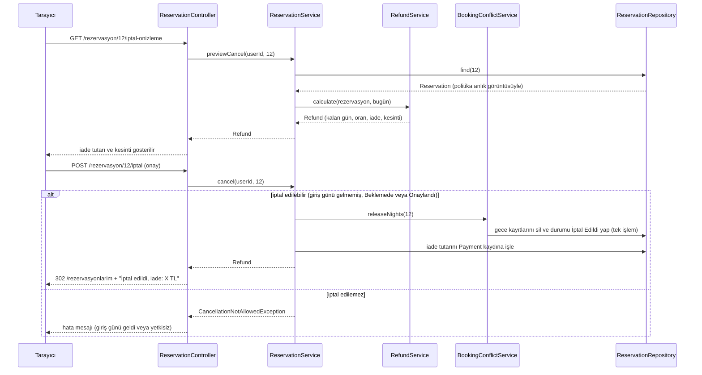
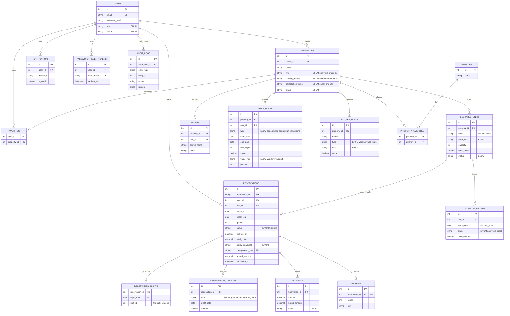
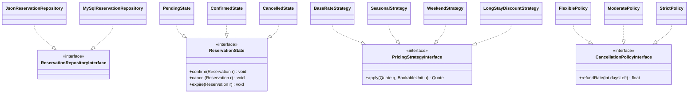
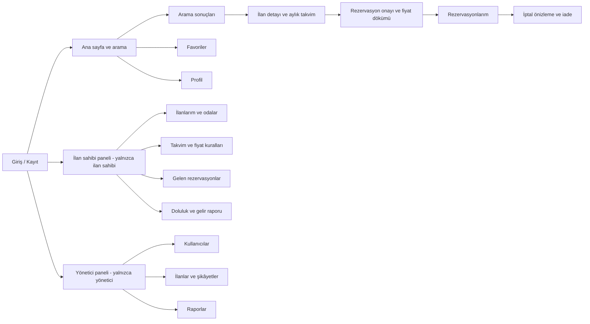
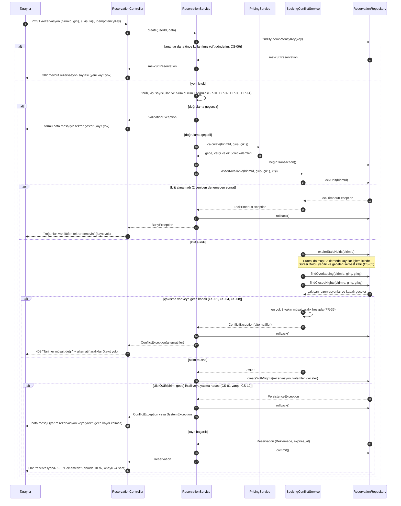

# Tasarım Belgesi — Otel / Kiralık Ev Rezervasyon Sistemi
 
Ders: PHP Programlama (Gümüşhane Üniversitesi) · Depo: ev-otel-rezervasyon · Dayanak: SRS v2.2
 
## Ekip ve Sunum 1 Anlatım Dağılımı
 
| Üye | Rol | Sunumda anlattığı bölüm | Süre |
|---|---|---|---|
| Kaan Şahin | Proje Yöneticisi | SRS: proje, 4 çekirdek problem, roller, en önemli 3 hikâye (US-01, US-02, US-03) | 1,5 dk |
| Utku Camuzcu | Mimar | Bölüm 1 (mimari), 2 (sınıf diyagramı), 5 (desenler) | 2 dk |
| İrem Ablak | Veritabanı ve Test Sorumlusu | Bölüm 3 (sıralama diyagramı), 4 (ER ve 3NF) | 2 dk |
| Onur Akbalık | Arayüz ve Dokümantasyon Sorumlusu | Bölüm 6 (arayüz), 7 (riskler), 8 (plan ve backlog) | 1,5 dk |
 
## Çekirdek Problemler (SRS Bölüm 4)
 
Projenin çekirdek problemi dört parçadır ve tasarım bu dört parça etrafında kurulmuştur:
 
| Kod | Çekirdek problem | Karşılayan sınıf | Bu belgede |
|---|---|---|---|
| ÇP-1 | Tarih aralığı çakışması (aynı gün çıkış–giriş serbest) | `BookingConflictService` | Bölüm 2, 3, 4 |
| ÇP-2 | Sezonluk dinamik fiyat | `PricingService` (Strategy) | Bölüm 2, 5 |
| ÇP-3 | İptal politikası ve iade hesabı | `RefundService` (Strategy) | Bölüm 2, 3.2, 5 |
| ÇP-4 | Çift rezervasyonun önlenmesi | `BookingConflictService` + `reservation_nights` UNIQUE | Bölüm 3, 4 |
 
---
 
## 1. Mimari
 
### 1.1 İstek akışı
 
Her istek aynı yoldan geçer: `public/index.php → Router → Controller → Service → Repository`. Bir katman yalnızca altındaki katmanı çağırır.
 
### 1.2 Katman tablosu
 
| Katman | Görevi | Asla yapmaz | Bu projedeki sınıflar |
|---|---|---|---|
| Router | Adrese göre controller metodunu seçer | İş kuralı içermez | `POST /rezervasyon → ReservationController::store` |
| Controller | `$_POST/$_GET` verisini alır, servisi çağırır, görünümü seçer | SQL yazmaz, hesap yapmaz | `AuthController`, `PropertyController`, `ReservationController`, `HostController`, `ReviewController`, `ComplaintController`, `ProfileController`, `AdminController` |
| Service | İş kuralları ve çekirdek algoritmalar | `$_POST` okumaz, HTML üretmez | **Çekirdek:** `BookingConflictService`, `PricingService`, `RefundService`. Diğer: `ReservationService`, `AvailabilityService`, `PaymentService`, `PropertyService`, `AuthService`, `UserService`, `ReviewService`, `ComplaintService`, `FavoriteService`, `NotificationService`, `ReportService`, `AuditService`, `PhotoService` |
| Repository | Veriyi okur ve yazar | İş kuralı içermez | `ReservationRepositoryInterface` (+ `JsonReservationRepository`, `MySqlReservationRepository`), `PropertyRepositoryInterface`, `BookableUnitRepositoryInterface`, `UserRepositoryInterface` ve diğer varlıkların arayüzleri |
| Model | Veriyi taşıyan sade sınıf | Veritabanına erişmez | `User`, `Property`, `BookableUnit`, `Reservation`, `ReservationNight`, `ReservationCharge`, `PriceRule`, `Payment`, `Review`, … |
| View | HTML'i gösterir, çıktıyı kaçışlar | Hesap yapmaz, veri çekmez | `views/search/`, `views/reservation/`, `views/host/`, `views/admin/` |
 
### 1.3 Klasör yapısı
 
```text
public/
  index.php                       # tek giriş noktası
src/
  Controller/                     # 8 controller
  Service/
    BookingConflictService.php    # çekirdek (ÇP-1, ÇP-4)
    PricingService.php            # çekirdek (ÇP-2)
    RefundService.php             # çekirdek (ÇP-3)
    ReservationService.php  AvailabilityService.php  PaymentService.php  ...
    Pricing/                      # Strategy: fiyat
      PricingStrategyInterface.php  BaseRateStrategy.php  SeasonalStrategy.php
      WeekendStrategy.php  LongStayDiscountStrategy.php
    Refund/                       # Strategy: iade
      CancellationPolicyInterface.php  FlexiblePolicy.php  ModeratePolicy.php  StrictPolicy.php
    Reservation/State/            # State: rezervasyon durumları
      ReservationState.php  PendingState.php  ConfirmedState.php
      CancelledState.php  RejectedState.php  ExpiredState.php  CompletedState.php
  Repository/                     # *RepositoryInterface + Json* / MySql* uygulamaları
  Model/
views/
database/                         # şema ve örnek veri (≥10 birim, ≥3 oda tipi)
tests/                            # PHPUnit (T-01 … T-15)
docs/                             # tasarim.md, wireframes/
storage/                          # JSON depo (Aşama 2) ve yüklenen resimler (public dışında)
bin/expire-holds.php              # zamanlanmış görev (süre dolumu, tamamlama)
```
 
**Kontrol sorusu:** "Veritabanını değiştirsem hangi dosyalar değişir?" Yalnızca `src/Repository/` altındaki uygulama sınıfları (`Json*` → `MySql*`). Çakışma kuralı, fiyat ve iade hesabı değişmez.
 
---
 
## 2. Sınıf diyagramı
 
Çekirdek akışı ve üç çekirdek servisi gösterir (19 sınıf/arayüz). Controller'dan Repository'ye doğrudan ok yoktur.

```mermaid
classDiagram
class ReservationController {
  +store() void
  +cancel() void
  +preview() void
}
class HostController {
  +saveCalendar() void
  +savePriceRule() void
}
class PropertyController {
  +search() void
  +show() void
}
class ReservationService {
  -ReservationRepositoryInterface repo
  +create(int userId, array data) Reservation
  +cancel(int userId, int reservationId) Refund
  +confirm(int reservationId) void
  +expireHolds() void
}
class BookingConflictService {
  -ReservationRepositoryInterface repo
  +reserve(int unitId, string checkIn, string checkOut, Quote quote, string key) Reservation
  +isAvailable(int unitId, string checkIn, string checkOut) bool
  +suggestAlternatives(int unitId, string checkIn, string checkOut) array
  +releaseNights(int reservationId) void
}
class AvailabilityService {
  -BookingConflictService conflict
  +searchAvailable(array criteria) array
  +monthCalendar(int unitId, int year, int month) array
}
class PricingService {
  -PricingStrategyInterface[] strategies
  +quote(int unitId, string checkIn, string checkOut) Quote
}
class RefundService {
  +calculate(Reservation r, string cancelDate) Refund
}
class PaymentService {
  +payAndConfirm(int reservationId) bool
}
class ReservationState {
  <<interface>>
  +confirm(Reservation r) void
  +cancel(Reservation r) void
  +expire(Reservation r) void
}
class ReservationRepositoryInterface {
  <<interface>>
  +createWithNights(Reservation r, array nights) void
  +findOverlapping(int unitId, string checkIn, string checkOut) array
  +lockUnit(int unitId) void
  +findByIdempotencyKey(string key) Reservation
  +releaseNights(int reservationId) void
}
class JsonReservationRepository {
  -string file
}
class MySqlReservationRepository {
  -PDO pdo
}
class PropertyRepositoryInterface {
  <<interface>>
  +findAvailableByCriteria(array criteria) array
}
class Reservation {
  +int id
  +string number
  +int unitId
  +string checkIn
  +string checkOut
  +string status
  +string expiresAt
  +float total
  +string policySnapshot
}
class ReservationNight {
  +int reservationId
  +int unitId
  +string nightDate
}
class BookableUnit {
  +int id
  +int propertyId
  +string roomType
  +int capacity
  +float basePrice
}
class Quote {
  +array nightlyLines
  +float discount
  +float tax
  +float total
}
ReservationController ..> ReservationService
HostController ..> PricingService
PropertyController ..> AvailabilityService
PropertyController ..> PricingService
ReservationService --> BookingConflictService
ReservationService --> PricingService
ReservationService --> RefundService
ReservationService --> PaymentService
ReservationService ..> ReservationState
AvailabilityService --> BookingConflictService
BookingConflictService --> ReservationRepositoryInterface
AvailabilityService --> PropertyRepositoryInterface
JsonReservationRepository ..|> ReservationRepositoryInterface
MySqlReservationRepository ..|> ReservationRepositoryInterface
Reservation "1" *-- "1..*" ReservationNight
Reservation --> BookableUnit
PricingService ..> Quote
```
 

 
**Gereksinim izi:** `BookingConflictService` → FR-11, 12, 18, 33–36 · `PricingService` → FR-14, 43, 44 · `RefundService` → FR-17, 45 · `ReservationState` → FR-15 · `ReservationNight` → FR-18, NFR-05. Her sınıfın bir gereksinimi vardır; olmayanı çıkarırız.
 
---
 
## 3. Sıralama diyagramları
 
### 3.1 Çekirdek akış: rezervasyon oluşturma (ÇP-1, ÇP-2, ÇP-4)
 
Hata dalları: çakışma (başka misafir aynı geceleri almış) ve çift gönderim.
 

 
> Not: `createWithNights` içinde `UNIQUE(birim, gece)` ihlali olursa bu da çakışma olarak ele alınır; uygulama kontrolü kaçırsa bile veritabanı çift kaydı reddeder (SRS 4.5).
 
### 3.2 İptal ve iade (ÇP-3)
 

 
---
 
## 4. ER diyagramı
 

 
`complaints` (şikâyet) tablosu okunabilirlik için çizilmedi: `id PK, sender_id FK → users, property_id FK, reservation_id FK, description, status ENUM, admin_note`.
 
### 4.1 Gerekçe ve 3NF
 
- **Varlıklar** Bölüm 2'deki model sınıflarından türetildi; her tabloda `id` adında otomatik artan PK vardır (ara tablolarda bileşik PK).
- **1-N ilişkiler:** FK her zaman "N" tarafındadır (ör. `reservations.unit_id`). **N-M ilişki:** ilan–olanak `property_amenities` ara tablosuyla kurulur (1NF: hücrede tek değer).
- **Para** `DECIMAL(10,2)`, tarih `DATE`, tarih-saat `DATETIME`, sabit seçenekler `ENUM`'dur.
- **2NF/3NF:** Ad, adres gibi bilgiler yalnızca kendi tablosundadır (ör. oda tipi adı `reservations` içinde tutulmaz, `unit_id` üzerinden gelir). Vergi/sezon kuralları ayrı tablolardadır, fiyat tutarı kuralın içine gömülmez.
- **Tek doğruluk kaynağı:** Doluluk yalnızca `reservation_nights` tablosundan türetilir; `calendar_entries` rezervasyon doluluğunu tutmaz, yalnızca ilan sahibinin kapattığı geceleri ve özel fiyatları tutar. Böylece iki yerde çelişen doluluk bilgisi oluşamaz.
- **Çift rezervasyonun veri düzeyindeki savunması:** `reservation_nights` tablosunda `UNIQUE(unit_id, night_date)`. Engelleyen durumdaki (Beklemede, Onaylandı) rezervasyonların her gecesi için bir satır vardır; iptal, ret, süre dolumu ve tamamlanmada satırlar silinir.
**Bilinçli iki istisna (sunumda sorulursa):**
 
1. `reservation_nights.unit_id`, `reservation_id`'den türetilebildiği için sıkı 3NF'yi bozar. Veritabanının `(unit_id, night_date)` benzersizliğini zorlayabilmesi için gereklidir. Tutarlılığı `(reservation_id, unit_id)` bileşik yabancı anahtarı garanti eder.
2. `reservations.total_price`, `reservation_charges` toplamından türetilebilir. Fiyat anlık görüntüsü olarak bilinçli saklanır; testle (T-13) kalemler toplamına eşitliği doğrulanır. Aynı şekilde `policy_snapshot`, ilanın politikasından kopyalanır, çünkü ilan politikası sonradan değişse de eski rezervasyonun iade koşulu değişmemelidir (BR-29).
---
 
## 5. Tasarım desenleri
 
Repository zorunlu; ek olarak State ve iki Strategy kullanılır. Her birinin gerekçesi dört cümlelidir ve diyagramdadır.
 

 
### 5.1 Repository
1. **Problem:** Aşama 2'de veriler JSON dosyalarında, Aşama 3'te veritabanında tutulacak; iş mantığı bundan etkilenmemeli.
2. **Desen:** Repository; `ReservationRepositoryInterface` ve `JsonReservationRepository`, `MySqlReservationRepository`.
3. **Alternatif:** Servislerin doğrudan dosya okuması veya SQL yazması.
4. **Neden:** Depolama değişince yalnızca Repository sınıfları değişir; servisler sahte (mock) repository ile test edilebilir (NFR-16).
### 5.2 State (rezervasyon durumları)
1. **Problem:** Rezervasyonun davranışı durumuna göre değişir (Beklemede onaylanabilir, İptal Edildi hiçbir şey yapamaz) ve geçersiz geçişler engellenmeli.
2. **Desen:** State; `ReservationState` arayüzü, `PendingState`, `ConfirmedState`, `CancelledState`, `RejectedState`, `ExpiredState`, `CompletedState`.
3. **Alternatif:** `ReservationService` içinde `if ($status == ...)` zincirleri.
4. **Neden:** İzinli geçişler (SRS 4.3) tek yerde ve durum başına ayrı sınıfta durur; yeni durum eklemek mevcut kodu bozmaz.
5. *Sorgulama:* Altı durumlu küçük bir makine için fazla karmaşık olabilir; geçiş tablosu (dizi) alternatifi hafiftir. State'i seçme nedenimiz, her geçişin gecelerle (serbest bırakma/koruma) yan etkisinin durum sınıfında toplanmasıdır.
### 5.3 Strategy (dinamik fiyat — ÇP-2)
1. **Problem:** Fiyat; takvim istisnası, sezon, hafta sonu ve uzun konaklama kurallarının sıralı biçimde uygulanmasıyla hesaplanır ve kurallar ilan sahibine göre değişir.
2. **Desen:** Strategy; `PricingStrategyInterface`, `BaseRateStrategy`, `SeasonalStrategy`, `WeekendStrategy`, `LongStayDiscountStrategy`; `PricingService` bunları sırayla çalıştırır.
3. **Alternatif:** Tek bir uzun `calculate()` metodunda iç içe `if` blokları.
4. **Neden:** Her kural ayrı test edilir (T-12), yeni kural (ör. erken rezervasyon indirimi) mevcut koda dokunmadan eklenir ve hesap sırası tek yerde görünür.
### 5.4 Strategy (iptal politikası — ÇP-3)
1. **Problem:** Esnek, orta ve katı politikaların iade oranı kalan güne göre farklı hesaplanır.
2. **Desen:** Strategy; `CancellationPolicyInterface`, `FlexiblePolicy`, `ModeratePolicy`, `StrictPolicy`; `RefundService`, rezervasyondaki `policy_snapshot` değerine göre doğru sınıfı seçer.
3. **Alternatif:** `RefundService` içinde `switch ($policy)` ile üç ayrı hesap.
4. **Neden:** Yeni politika eklemek yeni bir sınıf yazmak demektir; eşik günleri politika başına izole test edilir (T-14).
---
 
## 6. Arayüz
 
### 6.1 Sayfa haritası
 

 
### 6.2 Ekran taslakları
 
Aşağıdaki taslaklar metin tabanlıdır; `docs/wireframes/` klasörüne draw.io veya excalidraw ile PNG olarak da çizilmesi önerilir (Onur).
 
**Ekran 1 — Arama ve sonuçlar** (FR-06, 07, 08)
```text
+----------------------------------------------------------------+
| Otel / Kiralık Ev                          [Giriş]  [Kayıt ol] |
+----------------------------------------------------------------+
| Konum [__________]  Giriş [__/__/____]  Çıkış [__/__/____]     |
| Kişi [ 2 v ]  Tür [ Hepsi v ]  Oda tipi [ Hepsi v ]  [ ARA ]   |
| (hata mesajı: "Çıkış tarihi girişten sonra olmalı")            |
+----------------------------------------------------------------+
| Filtre: Fiyat [___]-[___]  Puan [ v ]  Olanaklar [x] Wi-Fi ... |
| Sırala: [ Fiyat v ]                                            |
+----------------------------------------------------------------+
| [foto]  Otel Karadeniz        4,5 ★   3 müsait oda             |
|         Trabzon                3 gece toplam: 4.862,00 TL      |
|                                                    [ Detay ]   |
+----------------------------------------------------------------+
```
 
**Ekran 2 — İlan detayı ve aylık müsaitlik takvimi** (FR-09, 10)
```text
+----------------------------------------------------------------+
| Otel Karadeniz — Trabzon                          4,5 ★        |
| [foto1] [foto2] [foto3]                                        |
| Açıklama ... Olanaklar: Wi-Fi, Kahvaltı ...                     |
| İptal politikası: ORTA (5+ gün %100, 1–4 gün %50)              |
+----------------------------------------------------------------+
| Oda [ Deluxe 204 v ]      < Temmuz 2027 >                      |
|  Pt Sa Ça Pe Cu Ct Pa                                          |
|   .  .  .  1  2  3  4     . müsait  X dolu  - kapalı           |
|   5  6  X  X  X  -  -                                          |
| Giriş [__] Çıkış [__] Kişi [ 2 v ]        [ Fiyatı göster ]    |
+----------------------------------------------------------------+
```
 
**Ekran 3 — Rezervasyon onayı, gecelik fiyat dökümü (çekirdek ekran)** (FR-11, 14, 36)
```text
+----------------------------------------------------------------+
| Rezervasyonu onayla                                            |
| Otel Karadeniz / Deluxe 204   9–12 Temmuz 2027 (3 gece, 2 kişi)|
+----------------------------------------------------------------+
| Gece          Açıklama                          Tutar          |
| 9 Tem (Cum)   1000 +%30 sezon +%20 hafta sonu   1.560,00 TL    |
| 10 Tem (Cmt)  1000 +%30 sezon +%20 hafta sonu   1.560,00 TL    |
| 11 Tem (Paz)  1000 +%30 sezon                   1.300,00 TL    |
| Konaklama toplamı                               4.420,00 TL    |
| Uzun konaklama indirimi                              0,00 TL   |
| Vergi (%10)                                        442,00 TL   |
| TOPLAM                                          4.862,00 TL    |
+----------------------------------------------------------------+
| İptal koşulu: ORTA — girişe 5+ gün kala %100 iade              |
| Bekletme süresi: 09:58 (anında rezervasyonda)                  |
| [ Onayla ve öde (simüle) ]   [ Vazgeç ]                        |
+----------------------------------------------------------------+
| HATA (çakışmada): "Seçtiğiniz tarihler artık müsait değil."    |
|   Alternatifler: [12–15 Tem]  [14–17 Tem]  [16–19 Tem]         |
+----------------------------------------------------------------+
```
 
**Ekran 4 — Rezervasyonlarım ve iptal önizleme** (FR-16, 17, 45)
```text
+----------------------------------------------------------------+
| Rezervasyonlarım          [ Gelecek ] [ Geçmiş ]               |
| No             Tarih            Durum       Tutar     İşlem    |
| RZ-20261014-A7 9–12 Tem 2027    Onaylandı   4.862,00  [İptal]  |
+----------------------------------------------------------------+
| İptal önizleme                                                 |
| Kalan gün: 3   Politika: ORTA   İade oranı: %50                |
| İade: 2.431,00 TL   Kesinti: 2.431,00 TL                       |
| [ İptali onayla ]   [ Vazgeç ]                                 |
+----------------------------------------------------------------+
```
 
**Ekran 5 — İlan sahibi: takvim ve fiyat kuralları** (FR-22, 43)
```text
+----------------------------------------------------------------+
| İlan sahibi paneli > Otel Karadeniz > Fiyat ve takvim          |
| Temel fiyat (Deluxe 204): [ 1000,00 ] TL                       |
| Fiyat kuralları                                [ + Kural ekle ]|
|  Tür             Parametre                 Değer      Sil      |
|  Sezon           1 Tem – 31 Ağu            +%30       [x]      |
|  Hafta sonu      Cuma, Cumartesi geceleri  +%20       [x]      |
|  Uzun konaklama  7+ gece                   -%10       [x]      |
| Takvim: gece seç -> [ Kapat ]  [ Aç ]  [ Özel fiyat: ____ ]    |
| (Rezervasyonlu geceler kilitli; kapatma denemesi hata verir)   |
+----------------------------------------------------------------+
```
 
**Ekran 6 — Doluluk ve gelir raporu** (FR-30)
```text
+----------------------------------------------------------------+
| Rapor   Tarih [01.07.2027] – [31.07.2027]  Kırılım [ Oda tipi v]|
| Doluluk oranı: %72   Net gelir: 184.250,00 TL   Rezervasyon: 41 |
| Oda tipi    Doluluk   Net gelir                                 |
| Deluxe      %80       96.000,00 TL                              |
| Standart    %65       88.250,00 TL                              |
| Durum dağılımı: Onaylandı 30 · İptal 8 · Tamamlandı 3           |
+----------------------------------------------------------------+
```
 
---
 
## 7. Riskler
 
| # | Risk | Olasılık | Etki | Önlem |
|---|---|---|---|---|
| 1 | **(Çekirdek)** Eş zamanlı isteklerde çift rezervasyon oluşması | Orta | Yüksek | İşlem + birim kilidi + `UNIQUE(birim, gece)`; 50 paralel istek testi (T-05) |
| 2 | **(Çekirdek)** Sınır günü hatası (çıkış günü gece sayılması) | Yüksek | Yüksek | Yarı açık aralık tek tanımı; veri güdümlü T-01 |
| 3 | **(Çekirdek)** Fiyat kurallarının yanlış sırada uygulanması veya yuvarlama farkı | Orta | Yüksek | Tek hesap sırası ve gece bazlı yuvarlama; T-12, T-13 |
| 4 | **(Çekirdek)** İade eşik günlerinde yanlış oran; politikanın sonradan değişmesi | Orta | Orta | Politika anlık görüntüsü; sınır günü testleri T-14 |
| 5 | Aşama 2 JSON deposunda eşzamanlı yazma / dosya bozulması | Orta | Yüksek | `flock`, geçici dosyaya yazıp yeniden adlandırma; T-10 |
| 6 | Yapay zekânın katman kurallarını bozması (çakışma kontrolünü Controller'a koyması) | Yüksek | Orta | Her istemde Bölüm 1 katman tablosunu bağlam vermek; PR incelemesinde katman kuralı kontrolü |
| 7 | Kapsamın büyümesi (çok sayıda FR) | Yüksek | Orta | SRS Ek A'daki asgari kapsam ve kapsam dışı listesine sadık kalmak; çekirdek problemler önce |
| 8 | Bir üyenin katkı vermemesi | Orta | Yüksek | Her işe sorumlu atamak, haftalık toplantı, sorunu erken bildirmek |
| 9 | Aynı dosyada çakışan değişiklikler | Yüksek | Düşük | Dal ve PR ile çalışmak, işleri dosya/bölüm bazında bölmek |
| 10 | Depo ayarlarına (dal koruması, pano) yönetici erişimi olmaması | Orta | Orta | Depoyu proje yöneticisine devretmek veya sahibinin ayarları yapması |
| 11 | Ortam sorunları (PHP sürümü, Composer) | Düşük | Orta | İlk gün kurulum; sorun olursa Laragon |
 
---
 
## 8. Plan
 
- **GitHub Projects panosu:** `<PANO-BAĞLANTISI-BURAYA>`
- **Kilometre taşları:**
| Kilometre taşı | Tarih | Kapsam |
|---|---|---|
| Sunum 1 | `<GG.AA.2026>` | `tasarim.md` ve backlog |
| Sunum 2 | `<GG.AA.2026>` | Aşama 2: çekirdek servisler, JSON depo, testler |
| Sunum 3 | `<GG.AA.2026>` | Aşama 3: veritabanı, güvenlik, rapor, tamamlama |
 
### 8.1 Başlangıç backlog'u (öncelik sırasıyla)
 
| # | Issue başlığı | FR / not | Etiket | Önerilen sorumlu |
|---|---|---|---|---|
| 1 | Proje iskeleti ve Composer kurulumu | Adım 0 | aşama-2 | Utku |
| 2 | Dal koruması ve PR akışı | — | dokümantasyon | Kaan |
| 3 | `tasarim.md`: mimari ve sınıf diyagramı | Bölüm 1, 2 | dokümantasyon | Utku |
| 4 | `tasarim.md`: sıralama diyagramları ve ER | Bölüm 3, 4 | dokümantasyon | İrem |
| 5 | `tasarim.md`: desenler | Bölüm 5 | dokümantasyon | Utku |
| 6 | `tasarim.md`: sayfa haritası ve ekran taslakları | Bölüm 6 | dokümantasyon | Onur |
| 7 | `tasarim.md`: riskler ve plan | Bölüm 7, 8 | dokümantasyon | Onur, Kaan |
| 8 | Çakışma kuralı: `BookingConflictService` ve T-01, T-02 | FR-11, 18, 33 | çekirdek, test | Utku |
| 9 | Şema ve `reservation_nights` UNIQUE kısıtı, örnek veri (≥10 birim, ≥3 tip) | FR-18, NFR-05 | çekirdek | İrem |
| 10 | Eşzamanlılık testleri (50 paralel istek) | T-05, T-06, T-10 | çekirdek, test | İrem |
| 11 | Dinamik fiyat: `PricingService` ve stratejiler, T-12, T-13 | FR-14, 43, 44 | çekirdek, test | Utku |
| 12 | İptal ve iade: `RefundService` ve politikalar, T-14 | FR-17, 45 | çekirdek, test | İrem |
| 13 | Rezervasyon oluşturma akışı ve bekletme süresi | FR-12, 13, 34, 35, 36, 37 | çekirdek | Kaan |
| 14 | Rezervasyon durumları (State) ve zamanlanmış görev | FR-15, 34, 40 | çekirdek | Utku |
| 15 | Kayıt, giriş, çıkış, roller | FR-01 – 05 | güvenlik | Kaan |
| 16 | İlan, oda ve resim yönetimi | FR-20, 21, 42, 46 | aşama-2 | Onur |
| 17 | Arama, filtreleme ve aylık takvim | FR-06 – 10 | aşama-2 | Onur |
| 18 | İlan sahibi paneli: takvim, fiyat kuralları, talep onayı | FR-22, 23, 38 | aşama-2 | Kaan |
| 19 | Doluluk ve gelir raporu | FR-30, T-15 | aşama-3 | İrem |
| 20 | Yönetici paneli, denetim kaydı, şikâyet | FR-25 – 29, 39, 41 | aşama-3 | Onur |
| 21 | Güvenlik: CSRF, XSS kaçışı, oturum, dosya yükleme | NFR-14, 15, 19 | güvenlik | Utku |
 
Her issue'da FR numarası ve kabul kriteri (SRS Bölüm 10, AC numaraları) bulunacak; commit mesajlarında issue numarası yazılacak (ör. `Çakışma kuralı eklendi #8`).
  <<<<<<< HEAD
# Tasarım Dokümanı: Otel / Kiralık Ev Rezervasyon Sistemi

## 1. Mimari

Her istek aynı yoldan geçer: `public/index.php` → Router → Controller → Service → Repository. Her katmanın tek bir görevi vardır ve bir katman yalnızca altındaki katmanı çağırır.

| Katman | Görevi | Asla yapmaz | Otel rezervasyon örneği |
|---|---|---|---|
| Router | Adrese göre hangi controller metodunun çalışacağını seçer | İş kuralı içermez | `POST /rezervasyon` → `ReservationController::store` |
| Controller | `$_POST/$_GET` verisini alır, servisi çağırır, görünümü seçer | SQL yazmaz, hesap yapmaz | `ReservationController` |
| Service | İş kuralları ve çekirdek algoritma | `$_POST` okumaz, HTML üretmez | `AvailabilityService::isAvailable` (çakışma), `PricingService::quote` (gecelik döküm), `CancellationService::refund` |
| Repository | Veriyi okur ve yazar | İş kuralı içermez | `ReservationRepositoryInterface` |
| Model | Veriyi taşıyan sade sınıf | Veritabanına erişmez | `Reservation`, `Property` |
| View | HTML gösterir, çıktıyı kaçışlar | Hesap yapmaz, veri çekmez | `views/reservations/form.php` |

**Çekirdek problem:** Tarih çakışması ve çift rezervasyonun önlenmesi (`AvailabilityService`), sezonluk dinamik fiyat (`PricingService`, Strategy deseni) ve iptal/iade hesabı (`CancellationService`).

### Klasör yapısı

```
ev-otel-rezervasyon/
├── public/
│   └── index.php
├── src/
│   ├── Router.php
│   ├── Controller/      (Auth, Property, Reservation, Profile, Host, Review,
│   │                     Complaint, Admin, Api)
│   ├── Service/         (Auth, Availability, Property, Reservation, Pricing,
│   │   │                 Cancellation, Favorite, Review, Notification, Complaint,
│   │   │                 User, Report, ImageUpload)
│   │   └── Pricing/     (Weekend, Season, LongStayDiscount stratejileri)
│   ├── Repository/
│   │   ├── *Interface.php
│   │   ├── Json/        (Aşama 2)
│   │   └── Pdo/         (Aşama 3)
│   └── Model/           (User, RoomType, Property, Photo, Amenity, PriceRule,
│                         Availability, Reservation, Cancellation, Review,
│                         Favorite, Notification, Complaint)
├── views/
├── database/
├── tests/
├── docs/
└── storage/
```

**Kontrol sorusu:** Veritabanını değiştirirsek yalnızca `src/Repository/Pdo/` altındaki sınıflar değişir.
=======
01.ana-sayfa.png
02.arama-sonuclari.png
03.ilan-detay-rezervasyon.png
04.rezervasyon-özeti.png
05.giris-kayit.png

use case kodu mermaid ile
## 2. Sınıf Diyagramı

Diyagram, çekirdek akışı gösterir: rezervasyon oluşturma, çakışma kontrolü, Strategy ile gecelik fiyat hesabı, iptal ve iade. Controller yalnızca Service'i, Service yalnızca Repository arayüzünü çağırır.


### Diyagramın okunuşu
- **Strategy:** `PricingService`, fiyat kurallarını `PricingStrategyInterface` üzerinden çalıştırır. Yeni kural eklemek yeni bir sınıf eklemektir.
- **Repository:** Servisler yalnızca `...RepositoryInterface` bilir. JSON (Aşama 2) ve PDO (Aşama 3) uygulamaları aynı arayüzü uygular.
- **Çekirdek problem:** `AvailabilityService::isAvailable`, `findOverlapping` ile çakışmaları arar. Aynı gün çıkış-giriş çakışma sayılmaz.
## 4. ER Diyagramı
 

 
### Normalizasyon Gerekçesi
 
Her varlık kendi tablosunda tutulmuş, tekrarlayan veriler (fotoğraf, olanak, gece, fiyat kalemi, favori) ara veya alt tablolara ayrılarak **1NF** sağlanmıştır. Bileşik anahtarlı tablolarda (`PROPERTY_AMENITIES`, `FAVORITES`, `RESERVATION_NIGHTS`) yalnızca anahtarın tamamına bağlı sütunlar bırakıldığı için **2NF** sağlanır. Müşteri, ilan veya şehir gibi bilgiler yalnızca bir tabloda tutulur ve diğer tablolar bunlara FK ile bağlanır; böylece anahtar olmayan sütunlar arasında geçişli bağımlılık kalmaz ve **3NF** sağlanır.
 
**Bilinçli iki istisna:**
 
1. `RESERVATION_NIGHTS.unit_id`: Kesin 3NF'ye göre fazlalıktır; ancak veritabanının `UNIQUE (unit_id, night_date)` kısıtını uygulayabilmesi için gereklidir. Bu kısıt çift rezervasyona karşı son savunmadır. Tutarsızlığı `(reservation_id, unit_id)` bileşik FK'si önler.
2. `RESERVATIONS.total_price`: `RESERVATION_CHARGES` toplamından türetilebilir; ancak fiyat anlık görüntüsü olarak bilinçli saklanır (BR-16) ve testle kalemlerin toplamına eşitliği doğrulanır.


## 3. Sıralama Diyagramı: Rezervasyon Oluşturma (Çekirdek: Çift Rezervasyon Önleme)
 

 
### Diyagramdaki durumlar
 
| Dal | Senaryo | Sonuç |
| --- | --- | --- |
| Başarılı | Birim müsait, kayıt ve geceler tek işlemde yazıldı | Rezervasyon Beklemede olur, geceler tutulur |
| Hata 1 | Çift gönderim (CS-06) | Yeni kayıt oluşmaz, mevcut rezervasyon gösterilir |
| Hata 2 | Geçersiz tarih, kapasite aşımı, pasif ilan | ValidationException, kayıt yok |
| Hata 3 | Kilit alınamadı | 2 deneme sonrası "yoğunluk" mesajı, kayıt yok |
| Hata 4 | Çakışma veya kapalı gece (CS-01, 04, 08) | ConflictException, en çok 3 alternatif önerilir |
| Hata 5 | UNIQUE(birim, gece) ihlali veya yazma hatası (CS-12) | Rollback, yarım kayıt kalmaz |
